<div align="center">

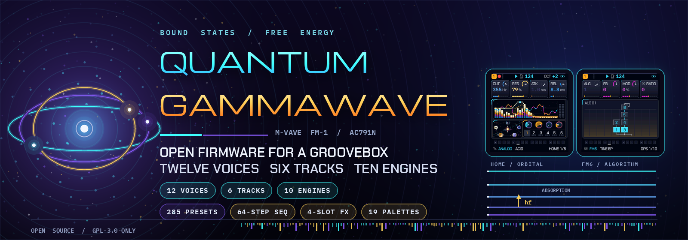

# QUANTUM GAMMAWAVE

**Twelve voices. Six tracks. Ten synthesis engines. One M-VAVE FM-1.**

<table>
  <tr>
    <td colspan="4" align="center"><a href="https://guillel51.github.io/Quantum-GammaWave/"></a></td>
  </tr>
  <tr>
    <td colspan="1" align="center"><a href="https://guillel51.github.io/Quantum-GammaWave/emulator/"></a></td>
    <td colspan="2" align="center"><a href="https://guillel51.github.io/Quantum-GammaWave/webapp/editor/"></a></td>
    <td colspan="1" align="center"><a href="https://guillel51.github.io/Quantum-GammaWave/webapp/installer/"></a></td>
  </tr>
  <tr>
    <td colspan="1" align="center"><a href="LICENSE"></a></td>
    <td colspan="2" align="center"><a href="https://www.gnu.org/licenses/gpl-3.0-standalone.html"></a></td>
    <td colspan="1" align="center"><a href="https://github.com/Guillel51/Quantum-GammaWave"></a></td>
  </tr>
</table>


<a href="https://guillel51.github.io/Quantum-GammaWave/emulator/"></a>
<a href="https://guillel51.github.io/Quantum-GammaWave/webapp/editor/"></a>
<a href="https://guillel51.github.io/Quantum-GammaWave/webapp/installer/"></a>

`v1.8.6` · identity `FM-1_965` · GPL-3.0-only · AC791N (JieLi WL82) · 240 × 240

Quantum GammaWave

Quantum GammaWave is a complete custom firmware for the M-VAVE FM-1, built to turn a compact synthesizer into a far more powerful and expressive instrument.

Designed around 6 independent tracks, 12 shared voices and 10 synthesis engines, it brings together a versatile sound library, deep sound editing, flexible modulation, a 64-step sequencer, arpeggiator, song chains and an extensive effects system. Every part of the instrument is designed to work together, giving you the freedom to shape sounds, build patterns, layer textures and create complex arrangements directly from the FM-1.

Its visual identity is just as important as its sound. The 240 × 240 interface features rich 16-bit graphics, animated visualizations, gradients and 19 selectable color palettes, with a consistent design language throughout the instrument. Physical controls remain immediate and intuitive, while the browser-based emulator and Web Studio make it possible to explore, edit and experience Quantum GammaWave without installing additional software.

This is more than a firmware update: it is an ongoing evolution of the FM-1 platform, combining expanded synthesis capabilities, a redesigned interface and carefully optimized performance while preserving the character and portability of the original hardware.
</div>

---

## What it is

Quantum GammaWave replaces the stock firmware of the **M-VAVE FM-1** with an instrument: six tracks, twelve
voices and ten synthesis engines, sequenced and played entirely on the unit, with a real DSP path — no
samples, no streaming, no host in the loop.

It is a whole ecosystem built around one firmware:

| | |
|---|---|
| **Firmware** | what the FM-1 runs: engines, sequencer, effects, UI, MIDI |
| **[Web emulator](https://guillel51.github.io/Quantum-GammaWave/emulator/)** | the same sources compiled to WebAssembly: the panel, playable in a browser |
| **[Web Studio](https://guillel51.github.io/Quantum-GammaWave/webapp/editor/)** | edits the real sound over Web MIDI / SysEx, with a live hardware view |
| **[USB installer](https://guillel51.github.io/Quantum-GammaWave/webapp/installer/)** | checks the package's SHA-256 and the flash chip before it enables INSTALL |
| **[Site](https://guillel51.github.io/Quantum-GammaWave/)** | the portal: current screens, download, documentation, preview channel |

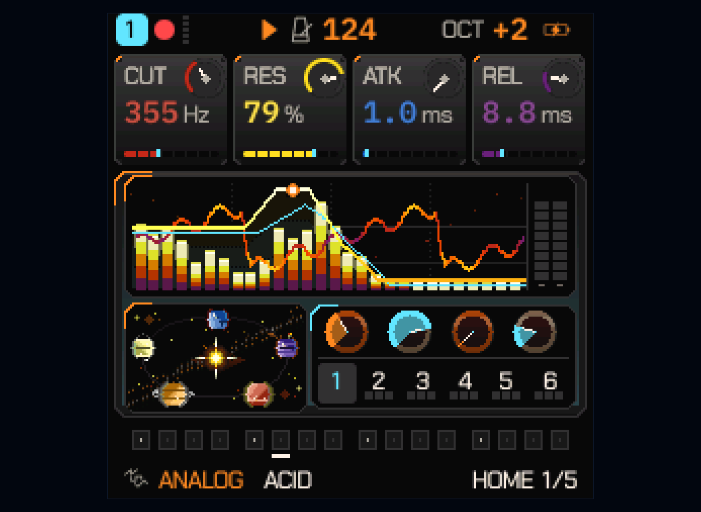

## Gallery

Quantum GammaWave screenshot gallery. All images rendered from the firmware at 240×240 (×3 scale for GitHub).

| | **HOME** | **EDIT: ANALOG** | **FM6** |
|---|---|---|---|
| **Row 1** |  | 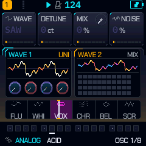 | 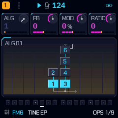 |
| **Row 2** | 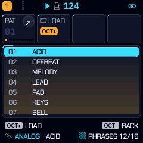 | 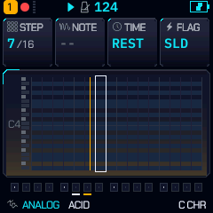 | 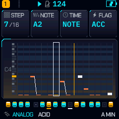 |
| **Row 3** | 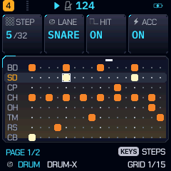 | 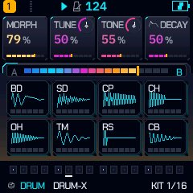 | 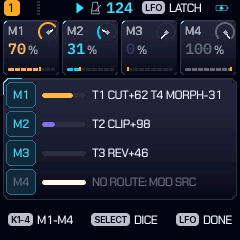 |
| **Row 4** | 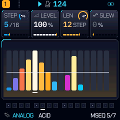 | 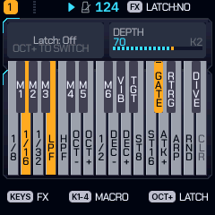 | 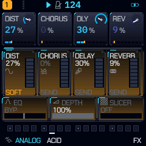 |
| **Row 5** | 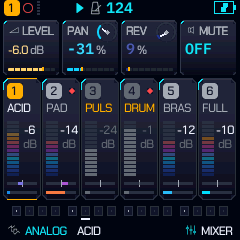 | 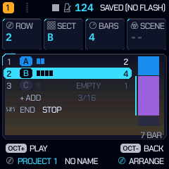 | 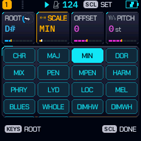 |
| **Row 6** | 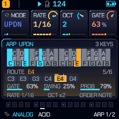 | 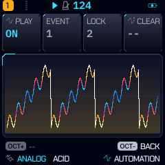 | 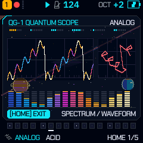 |
| **Row 7** | 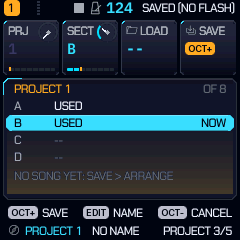 | 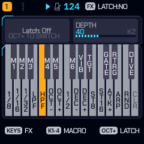 | 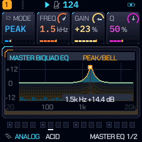 |
| **Row 8** | 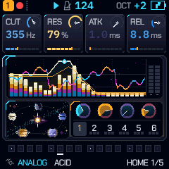 | 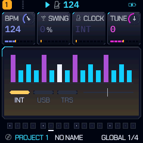 | 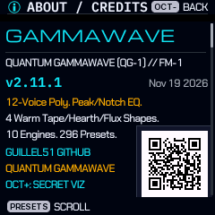 |
| **Row 9** | 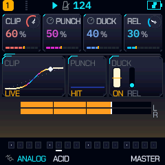 | 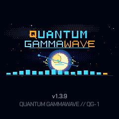 | 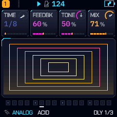 |
| **Row 10** | 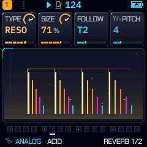 | 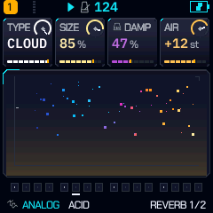 |  |

*All 37 screenshots rendered from the firmware at 240×240, scaled ×3 for GitHub display. Original PNGs reside in `assets/screenshots/`.*

---

## Introduction

Quantum GammaWave is a complete instrument built into an **M-VAVE FM-1**: a six-track FM and physical-modelling
groovebox that is sequenced, played and mixed entirely on the unit. Twelve voices across ten engines, a
six-track sequencer with p-locks and probability, a chord and scale engine, three send effects plus a master
bus, a drum machine, a performance layer — all of it running on the FM-1's own processor, with no computer in
the loop, no samples and no streaming.

What you hold is one instrument in four pieces:

- **A firmware** that boots the FM-1 into Quantum instead of its stock shell, drawn on the unit's 240 × 240
  panel and played with its fourteen buttons and seven encoders.
- **A web emulator** built from the same sources: the panel, playable in a browser tab.
- **A Web Studio** that edits the real instrument over Web MIDI, with a live view of what it is playing.
- **An installer** that verifies the package's SHA-256, size and the flash chip before it offers to write.

| | |
|---|---|
| **Voices / tracks / engines** | 12 · 6 · 10 (ANALOG, PHASE, FM6, LOFI, VOICE, WHEEL, NOISE, DRUM, WTABLE, ADDTV) |
| **Sound bank** | 285 factory presets (283 browsable + 2 legacy kits), audited as data and measured as sound |
| **Sequencing** | six tracks, per-step p-locks, probability and ratchets, arpeggiator, chord and scale tools |
| **Effects** | CHORUS, DELAY, REVERB sends, EQ / compressor / width on the master bus, punch-in FX |
| **Screen** | 240 × 240 RGB565, fourteen colours per theme, nineteen palettes (GREY and MONO included) |
| **Package** | 610 959 B, checked by SHA-256 and size (integrity, not a signature — see `docs/SIGNING.md`) |
| **Verification** | 303 golden renders, a full host suite, an AC791N build budget, an emulator and a portal |

It is a personal instrument that grew into a small ecosystem: the firmware is what the FM-1 runs, and the
emulator, the studio, the installer and this documentation are built from the same tree, released together and
versioned together. Nothing on this page is a mock-up: every screenshot is rendered from the firmware in
`assets/screenshots/`, and every figure quoted here comes from a test or a build that can be re-run.

## Synthesis engines

Ten engines, all digital, all edited from the panel (`EDIT` page 1 and 2) and from the Web Studio:

| Engine | What it is | Edit |
|---|---|---|
| **ANALOG** | virtual-analog: two oscillators, sub, noise, ring, filter, drift | waveform, shape, detune, filter, envelope |
| **FM6** | six-operator FM, eight algorithms, feedback | algorithm, ratios, levels, envelopes, feedback |
| **PHASE** | phase-distortion / CZ-style, two lines | waveform, harmonics, distortion, envelope |
| **WHEEL** | tonewheel organ: nine drawbars, percussion, click, drive, rotary | registration, bars, percussion, drive, rotor |
| **VOICE** | formant / vowel synthesis | vowel, formant shift, breath, envelope |
| **LOFI** | reduced-rate and reduced-depth digital, retrigger and clock | rate, depth, clock, retrigger, envelope |
| **DRUM-X** | drum synthesis: twelve kit lanes, per-hit tune and decay | kit, tune, decay, snap, mute groups |
| **NOISE** | noise-based percussion and textures | colour, band, decay, tone |
| **WTABLE** | wavetable: eight frames morphed by hand, LFO or envelope, with a tilt for harmonics | table position, harmonics, unison, filter |
| **ADDTV** | additive: eight partials, each with its own phase and decay; SPECTRUM morphs eight profiles, STRETCH makes them inharmonic | spectrum, tilt, spectral decay, stretch |

285 factory presets are spread across them (283 browsable, plus two legacy kits kept for the projects that
still name them), plus user slots. Presets and projects from earlier
versions keep loading.

## Tracks, voices and CPU

| Setting | Tracks | Notes |
|---|---|---|
| **ECO** | 4 | the lightest: fewer parts, no chorus, the slicer off, every reverb a spring |
| **BAL** | 5 | the middle setting |
| **FULL** | 6 | all six parts, the full effects chain |

Twelve voices are shared by the parts, with psychoacoustic stealing: a released tail about to die goes
first, then the quietest note, and the lowest held note of a POLY part is protected. Core 0 renders the
master buses, the UI and tracks 1–3; core 1 renders tracks 4–6.

## Sequencing and performance

- **64 steps a track**, six tracks, with per-step velocity, gate, timing, ratchet, conditions and
  parameter locks (automation events or one-shot locks).
- **Patterns** per engine with `PATTERNS`, and **MUTATE** to vary what is already playing.
- **ARP** with modes, octaves, walk and chord memory; **SCALES / CHORDS**; **STRUM**; **ROLL**.
- **Songs**: sixteen chain rows of sections with their bar counts.
- **Punch-in FX** on the fly: stutter, arp repeat, half tempo, octave, random, decay and more.
- **Live recording**, per-track mute and solo, and a **GLO** layer that recalls a whole performance state.

## Effects

- **Five reverbs**: ROOM, SPRING, SHIMMER, RESO and CLOUD, each with its own decay and mix.
- **Delay** with its own bars, **chorus**, and a **slicer** that plays recorded material back in time.
- **Parametric master EQ** with a graphic display, a **limiter**, and **duck** / **punch** on the master bus.
- Per-track sends, an FX rack per track, and a mixer with six channels.

## Interface

- **HOME**: five screens. **MAIN** is the system — a star, five orbits and five worlds in a 91 × 55 px bay, each answering
  its tracks and its own touch, under the galaxy band; **VISUALIZER** is the full-screen scope; **OVERVIEW**
  the part at a glance; **MIX** the six channels; **PERFORM** the live settings. The footer counts them
  (`HOME n/5`).
- **Full-screen visualizer** (HOME twice): phosphor oscilloscope, phase trace, spectrum bars with peaks, the
  six track meters and the quantum motes.
- **Pages** for each engine, the FX rack, the mixer, the sequencer, the presets, the master bus, MIDI, the
  console and the preferences, on a 240 × 240 panel with fourteen buttons and seven encoders.
- The whole UI is rendered by the firmware sources and checked by the render sweep and its alignment lint.

## Accessibility

Quantum GammaWave speaks to the **FM-1 Screen Reader** ([charlesvestal/fm1-reader](https://github.com/charlesvestal/fm1-reader)) over USB-MIDI: the screen's name when it changes (HOME's five, MENU, CONFIRM and each page's own title), a HOME card's value and unit as its knob turns (once it settles, as the protocol asks), the sound a track loads (`ANALOG BRASS`), and everything the top bar says. Nothing is sent while no reader is listening, so a DAW on the same port never sees a byte, and the audio path gains no call.

Open the reader page in Chrome or Edge with the FM-1 plugged in and press Connect. The words file is not published yet: the reader applies its own common rules. What is announced, what is not (MENU rows, knobs outside HOME, lists), what it costs and how to test it: [`docs/ACCESSIBILITY.md`](docs/ACCESSIBILITY.md). The autonomous readers Tonitor and Bigorna (speech from the headphone output) are studied there as the alternative not taken.

## MIDI, projects and tools

- **USB-MIDI** in and out, with channel routing, a selectable track, and **SysEx** for the Web Studio and for
  backup / restore.
- **Projects**: song slots, patterns, automation, mixer and sound, saved and loaded on the unit.
- **Web Studio** edits the real sound over Web MIDI, and its hardware view shows the panel live.
- **Backup and restore** read the unit's flash through the loader.

## Hardware

| | |
|---|---|
| Device | M-VAVE FM-1 (desktop groovebox / synthesizer) |
| SoC | JieLi AC791N / WL82, dual-core `pi32v2`, single-precision FPU |
| Memory | 578 KB SRAM reported by the SDK; the firmware keeps `.data + .bss` inside 96 KiB |
| Flash | 1 MiB SPI NOR, XIP at `0x02000000` |
| Panel | 240 × 240 ST7789-class RGB565 |
| Controls | 14 buttons, 7 rotary encoders, the MASTER pot and 27 micro-switch keys |

Only two flash parts are accepted by the loader — P25Q80H (`0x856014`) and UCUN UC25HQ80 (`0xB36014`) — and
an unknown part is refused before anything is erased.

**Stock firmware.** The installer recognises M-VAVE's official **V15 (`FM-1_015`)** and **V16
(`FM-1_016`)** releases, pinned by SHA-256 and by the layout measured from each file, and installs over
either of them; a unit running either one can also be returned to its pinned official file. V16's own
package is larger (`0xA9000` flash image) than the update loader's write window, so a QG package is
never patched from it. What was verified on a host, and what still needs a unit, is in
[`docs/FM1_V16.md`](docs/FM1_V16.md).

## Installing

The installer is a web page that talks to the unit over USB-MIDI, and it is the only write path:

1. Open the **[installer](https://guillel51.github.io/Quantum-GammaWave/webapp/installer/)** in Chrome or
   Edge, with a data cable (not a charge-only one).
2. It re-hashes the package (**SHA-256** + size), holds it to the published record and the version floor, and
   verifies the firmware hashes inside it. `v3.1.1` is the package this tree builds; `v2.9.7`
   was published by the tag workflow on 2026-11-13. Both ship **unsigned by design**: that is integrity, not
   authenticity, and the page says so instead of implying a signature. If anything fails, INSTALL stays
   disabled and the page says why.
3. The loader reads the **real flash chip** on the unit and refuses anything but the two parts above.
4. The write covers `0x04000–0x92FFF`; factory data is preserved, and the loader is the recovery path.

**Before you write:** keep a backup of your unit, and read
[`FM1_INSTALLATION_SAFETY_AUDIT.md`](docs/history/FM1_INSTALLATION_SAFETY_AUDIT.md). The installer never writes without
your confirmation, and there is no secure boot on this hardware — a verified package is not a guarantee about
a particular unit.

## Building from source

```sh
# target firmware (JieLi pi32v2 clang + the AC79 SDK)
JIELI_TOOLCHAIN=/path/to/toolchain AC79_SDK=/path/to/AC79_SDK python3 tools/build.py

# the 10-voice profile, and a pool size other than the default
FELUCCA_VOICES=10 python3 tools/build.py
FELUCCA_VPOOL=18 python3 tools/build.py

# the host tests: golden renders, voice / routing checks, UI, CPU budget
NO_PACKAGE=1 sh tests/run_tests.sh

# the browser emulator (needs emcc)
sh web/emu/build.sh
```

`build.sh` produces the `.fwsc` package. See [`BUILDING.md`](BUILDING.md) for the full setup and
[`docs/`](docs/) for the audits, the validation matrix and the memory baseline.

## Documentation

| | |
|---|---|
| [`docs/MANUAL.md`](docs/MANUAL.md) | the instrument, page by page |
| [`docs/VOICE_POOL.md`](docs/VOICE_POOL.md) | how the 12-voice pool works and what it measured |
| [`docs/OPTIMIZATION_BASELINE.md`](docs/OPTIMIZATION_BASELINE.md) | the memory regions and their floors |
| [`docs/VALIDATION_MATRIX.md`](docs/VALIDATION_MATRIX.md) | what is proven, by which test, on what |
| [`docs/HARDWARE_SPECS_FM1.md`](docs/HARDWARE_SPECS_FM1.md) | the unit as the code sees it |
| [`docs/EMULATOR_FIDELITY.md`](docs/EMULATOR_FIDELITY.md) | what the emulator does and does not reproduce |
| [`docs/FM1_HUB_READINESS.md`](docs/FM1_HUB_READINESS.md) | what The Firmware Hub asks for, what is done, and what still needs a real unit |
| [`docs/FM1_HUB_AUDIO_PROVENANCE.md`](docs/FM1_HUB_AUDIO_PROVENANCE.md) | every distributed audio and binary asset, its author and its licence |

## What this project does not claim

- **What the physical units prove and what they do not.** Three M-VAVE FM-1 units have run this firmware,
  the newer of the three with the second of the two accepted SPI NOR parts (owner's report, recorded in
  [`docs/HARDWARE_VALIDATION.md`](docs/HARDWARE_VALIDATION.md)). No captured artefact from those units -- dump,
  scope trace, recording -- is stored in this repository, so treat it as a compatibility report, not as a
  measurement you can reproduce from the tree. Stack depth, interrupt timing and audio headroom **on the unit**
  are still not measured here.
- Both flash parts are accepted by the code and have been seen in the field on those three units; the write
  path is the same for both and no per-part stress campaign is claimed.
- Twelve voices are validated by the host suite and the static CPU budget as well as by playing on those
  units; no blind listening test of the stealing order is claimed.
- No secure boot, no DRM, no vendor material in the packages.

## Credits and licence

GPL-3.0-only. Quantum GammaWave is an evolution of **Pocket GammaWave (GW-1)** by **Frederic Valente
(@fvalente)** — the GW-1 firmware line, its drum kits, its keys/trap presets and its persistence work — built on
**JIANT FM** and **Felucca** by **Leo Kuroshita (@kurogedelic) / Hügelton Instruments**. The published installer,
the emulator's CI and build record, the FX layer and the QUANTUM preset bank come from **Guillermo Lauria**;
**David Konsumer (@konsumer)** did the first install on a stock unit, the loader's chip check, the resume path and
the releases by tag. The original copyright notices,
the credits and the texts in [`LICENSES/`](LICENSES/) are kept; the JieLi SDK files that a package carries are
Apache-2.0, and [`LICENSING.md`](LICENSING.md) says which is which.
