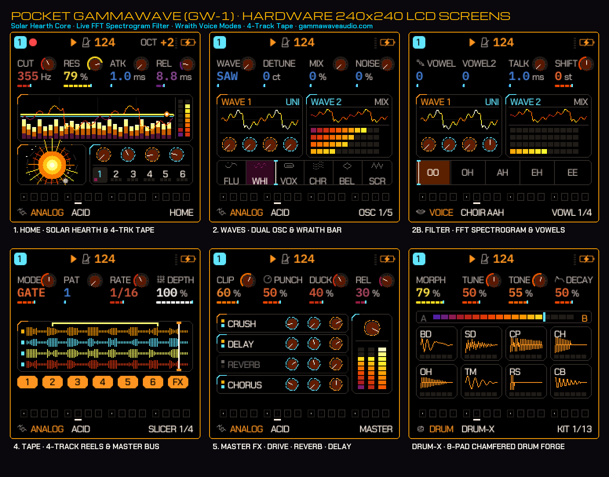
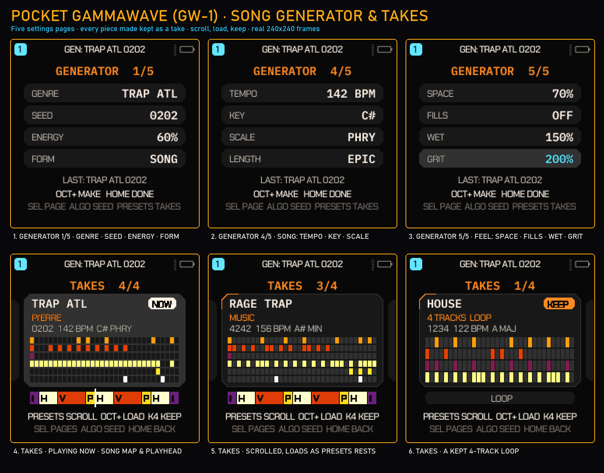
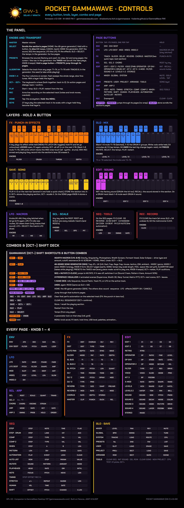
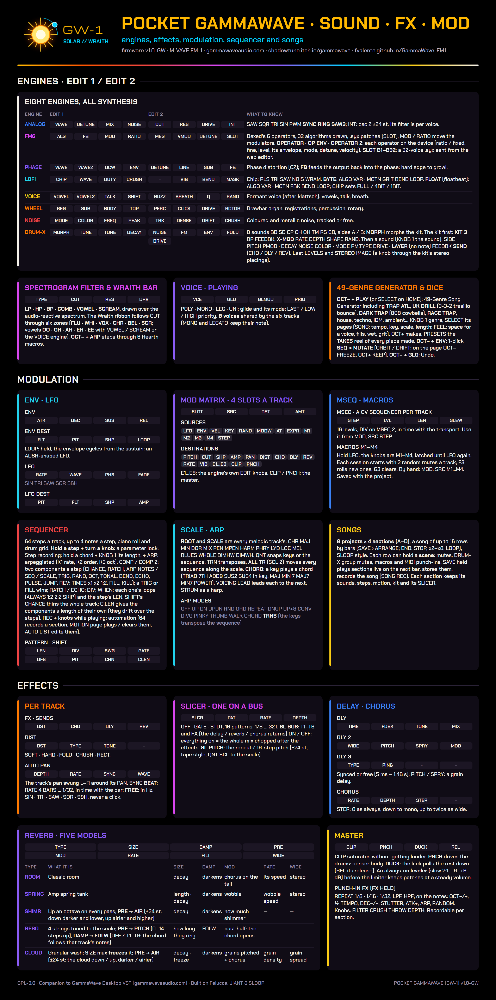

# POCKET GAMMAWAVE (GW-1) — M-VAVE FM-1 Firmware & Web Studio

**GammaWave-style HUD · Hearth macros · Wraith ribbon · VOWEL & SCREAM filters · 49-genre song generator (incl. Trap ATL, UK Drill, Dark Trap, Rage Trap) · Web Studio** — the open-source hardware & browser companion to the **[GammaWave desktop synthesizer](https://gammawaveaudio.com/)**.

[](https://shadowtune.itch.io/gammawave)
[](https://gammawaveaudio.com/)
[](https://fvalente.github.io/GammaWave-FM1/)
[](https://fvalente.github.io/GammaWave-FM1/webapp/editor/)
[](https://fvalente.github.io/GammaWave-FM1/webapp/installer/)
[](LICENSE)

> **Like the sound and workflow?** The full **[GammaWave desktop synth](https://shadowtune.itch.io/gammawave)** is a dual-oscillator hybrid (subtractive, FM, granular) with the Hearth saturation engine, a 7-engine filter, 3-layer granular FX, 32-voice polyphony and full DAW automation — VST3 and Standalone on Windows, macOS and Linux, plus AU on macOS.
> - **Buy the desktop plugin:** <https://shadowtune.itch.io/gammawave>
> - **Official website:** <https://gammawaveaudio.com/>
> - **Try the firmware in your browser (emulator):** <https://fvalente.github.io/GammaWave-FM1/>
> - **Web Studio (editor, demo songs, tape lanes):** <https://fvalente.github.io/GammaWave-FM1/webapp/editor/>
> - **USB web installer:** <https://fvalente.github.io/GammaWave-FM1/webapp/installer/>

---

## Hardware screens (240×240)



*Real 240×240 RGB565 frames from Pocket GammaWave (`v1.0-GW`). Top row: **HOME** (filter curve over an audio-reactive spectrum, the Hearth sun with its orbiting moon, tracks T1–T6), **EDIT 1** of ANALOG (two live scopes over the Wraith ribbon) and **EDIT 1** of the VOICE engine (the vowel ribbon OO · OH · AH · EH · EE). Bottom row: the **SLICER** page (drawn as four tape lanes), **FX > MASTER** (CLIP / PUNCH / DUCK and the FX rack) and the **DRUM** kit page (8 pads, A/B morph).*

### The song generator and its TAKES reel



*Real frames of the GEN screen, rendered by the firmware's own drawing code in the GAMMA palette (`docs/gw1-generator.png`). Top row: three of the generator's five settings pages, turned with **SELECT** — **1/5** genre, seed, energy, form; **4/5 SONG** (tempo, key, scale, length); **5/5 FEEL** (space for a voice, fills, wet, grit; the knob last turned is lit). Bottom row: **TAKES**, opened with **PRESETS** — every piece the generator makes goes on the reel as a card: the genre and its trap flavour (or the tracks and the form), the seed, tempo, key and scale, the first two bars of each live track (one row a track, coloured by its part: drums, bass, pad, lead, arp), and the song's sections as blocks (trap: **I**ntro, **H**ook, **V**erse, **P**re-hook) with the playhead on the take playing. **NOW** marks the music playing, **KEEP** a take kept (KNOB 4), the cards either side the takes before and after.*

---

## What's in Pocket GammaWave (`v1.0-GW`)

- **GammaWave HUD** on the FM-1's 240×240 screen, in the GAMMA palette (default), plus THERMAL and WRAITH palettes:
  - **HOME**: the selected track's filter response curve drawn over a 28-bar audio-reactive spectrum display, the Hearth sun with an orbiting moon, and the T1–T6 track strip.
  - **EDIT pages**: two live scope traces above the **Wraith ribbon** — six zones (`FLU` · `WHI` · `VOX` · `CHR` · `BEL` · `SCR`) whose needle follows the filter cutoff (and the filter LFO). With the VOWEL or SCREAM filter, or the VOICE engine, the ribbon shows the vowels `OO` · `OH` · `AH` · `EH` · `EE` instead.
  - Boot splash with the Hearth sun and `POCKET GAMMAWAVE // GW-1`; the ABOUT page carries a QR code to gammawaveaudio.com.
- **Two new filter types and four new drive types** on every track: filter `VOWEL` and `SCREAM` (after `LP`, `HP`, `BP`, `COMB`), drive `HEARTH`, `BLAST`, `PLASMA` and `FLUX`.
- **49-genre song generator (GEN)** — open it with **`[OCT−] + [PLAY]`**, or turn **SELECT** on HOME. Page 1: **KNOB 1** genre, **KNOB 2** seed, **KNOB 3** energy, **KNOB 4** form (LOOP / PARTS / SONG); **SELECT** turns the five pages (drums, bass, chords, arp; lead, complexity, swing, humanize; SONG: tempo, key, scale, length; FEEL: space, fills, wet, grit); **ALGORITHM** turns the seed (while the music plays: a new take once it rests); **OCT+** makes the piece, **PLAY** auditions it, **HOME** closes. **PRESETS** opens **TAKES**, the reel of every piece made (the last 32; kept ones stay): scroll it, and the take under the cursor plays (OCT+ when stopped), **KNOB 4** keeps one. Genres include:
  - **`TRAP ATL`** (136–150 BPM, half-time bounce, 808 sub, hi-hat rolls and triplets, bell / flute / key melodies)
  - **`UK DRILL`** (140–145 BPM, 3-3-2 hi-hat gallop, late snare, sliding 808, dark strings and choirs)
  - **`DARK TRAP`** (130–148 BPM, Memphis-style cowbell, clipped 808, phrygian bells)
  - **`RAGE TRAP`** (140–160 BPM, Whole Lotta Red or MUSIC flavour: square video-game leads or wobbling stabs, a crushed 808)
  - plus `GAMMAWAVE`, `WRAITHWAVE`, house, techno, trance, electro, EBM, synth pop, darkwave, post punk, motorik, funk, disco, boom bap, UK garage, dubstep, breaks, drum & bass, dub, jazz, bossa, afrobeat, ambient, neo-classical, soundtrack, IDM and more.
  - Pieces are 32 or 64 steps (2 or 4 bars per section) depending on the genre's chord rhythm.
- **One-press MUTATE** — **`[OCT−] + [ENV]`** jumps to **SEQ > MUTATE**. If MUTATE was off on the track it switches it on with SOUND every 2 bars, PATTERN every 4 bars and AMOUNT ≈ 50 %:
  - **`ORBIT`** (the default) mutates notes and timbre while pulling back toward the original pattern; **`DRIFT`** keeps wandering. Intervals: 1, 2, 4, 8, 16 or 32 bars.
  - On the MUTATE page **OCT−** freezes the current mutation and **OCT+** keeps it as the new pattern.
- **Hearth macros** — **`[OCT−] + [ARP]`** steps through six drive/filter macros (`1/6 HEARTH GRAVITY` … `6/6 SOLAR ECLIPSE!`); macros 4–6 switch the filter to SCREAM or VOWEL, and 6 also raises the master DUCK and PUNCH. `[OCT−] + [GLO]` takes a macro back.
- **Hidden visualizer** — **`[OCT−] + [HOME]`** (or MENU > ABOUT, then OCT+): four animated scenes, `1/4 SUPERNOVA`, `2/4 WRAITH 3D`, `3/4 WARP TUNNEL`, `4/4 MATRIX FFT`, which pulse while the sequencer plays. **OCT+** (or PRESETS / ALGORITHM) changes scene, **OCT−** leaves.
- **Web Studio** (browser, [webapp/editor](https://fvalente.github.io/GammaWave-FM1/webapp/editor/)) — edits the FM-1 live over Web MIDI, or runs on its own in simulator mode:
  - four instant demo songs and its own 49-genre generator (the same genre list; its patterns are generated in the browser and won't match the device's for the same seed);
  - **4 tape lanes (T1–T4)**: DUMP a track's pattern into a lane, layer and bounce lanes, mute and clear them — they hold note patterns, not recorded audio;
  - **EXPORT .WAV**: renders the current song and the tape lanes to a 16-bit **44.1 kHz** stereo WAV for your DAW;
  - the Wraith bar (six zone buttons, a 0–127 slider, or drag on the LCD) and SEQ MUTATE (MUTATE NOW, ORBIT, DRIFT, AMOUNT, FREEZE, KEEP ANCHOR).

---

## The `[OCT−]` shift deck

Hold **`[OCT−]` on its own first**, then press the second button. (A plain OCT− tap still lowers the octave; the octave is put back when a shortcut fires.) The deck works from HOME and the parameter pages — not inside menus or dialogs, and not on pages where OCT− has its own job (on MUTATE it is FREEZE).

| Shortcut | Action |
| :--- | :--- |
| **`[OCT−] + [ARP]`** | Next of the 6 Hearth macros (drive type and amount, cutoff, resonance, filter type) on the selected track |
| **`[OCT−] + [PLAY]`** *(or `[REC]`)* | Open the 49-genre generator (GEN) |
| **`[OCT−] + [ENV]`** *(or `[SCL]`)* | Jump to SEQ > MUTATE (switches MUTATE on if it was off) |
| **`[OCT−] + [HOME]`** *(or `[SAVE]`)* | Open the visualizer |
| **`[OCT−] + [SEQ]`** | Dice the selected track's sequence |
| **`[OCT−] + [EDIT]`** | Dice the selected track's sound |
| **`[OCT−] + [FX]`** / **`[OCT−] + [LFO]`** | Dice the track's FX / LFO |
| **`[OCT−] + [GLO]`** *(or `GLO + G4`)* | Undo; again: redo |

The editing actions ask you to stop the song chain first (`STOP TO EDIT`), as their GLO-layer versions do.

**Selecting tracks:** turn **ALGORITHM** to select T1–T6 from any page. Tap **EDIT** repeatedly to step through the engine's pages: EDIT 1 → EDIT 2 → (MORPH, RETRIG or the FM6 operator pages, depending on the engine) → FILTER → VOICE.

---

## Printable cheat sheets

| Controls & shift deck | Sound · filter · FX · mod |
| --- | --- |
| [](docs/cheatsheet-controls.png) | [](docs/cheatsheet-sound.png) |
| Every knob, button, held keymap layer (`FX`, `GLO`, `SAVE`, `EDIT`, `LFO`, `SCL`, `SEQ`, `REC`) and page knob assignment. **[PDF](docs/cheatsheet-controls.pdf)** | The synthesis engines, filter types, the `MOD` matrix, `MSEQ`, `MUTATE` and master FX. **[PDF](docs/cheatsheet-sound.pdf)** |

Full user manual: **[English (`docs/MANUAL.md`)](docs/MANUAL.md)** · **[Español (`docs/MANUAL.es.md`)](docs/MANUAL.es.md)**. Chapter 17 of the manual gathers the GW-1 additions (the shift deck, the Hearth macros, GEN, the new filter and drive types, the screens and the visualizer).

---

## Synthesis engines & sound architecture

### 1. Eight synthesis engines (no samples)
- **`ANALOG`**: dual virtual-analog oscillators (`SAW`, `SQR`, `TRI`, `SIN`, `PWM`, `SYNC`, `RING`, `SAW3`, and the dirty sines `TUBE` — GammaWave's Hearth tube curve — and `FOLD` — WRAITH's Blast wavefolder — whose amount is MORPH plus ENV/LFO → SHAPE) with interval (`INT ±24 st`), detune, oscillator mix and noise, through the track filter (`CUT`, `RES`, `DRIVE`).
- **`FM6`**: 6-operator DX7-style FM (DX7 `.syx` voices load through the Web Studio), the 32 algorithms drawn on screen, per-operator editing on the device (`OPERATOR`, `OP ENV`, `OPERATOR 2`) and a 32-voice user bank (`B1–B32`).
- **`PHASE`**: CZ-style phase distortion with feedback (`FB`), from warm brass to digital growl.
- **`LOFI`**: 1-bit, 4-bit and 8-bit chip voices plus 32-formula **Bytebeat (`BYTE`)** and **Floatbeat (`FLOAT`)** engines tuned to the keyboard scale.
- **`VOICE`**: formant voice (`VOWEL`, `VOWEL2`, `TALK`, `SHIFT`, `BUZZ`, `BREATH`) — its EDIT page shows the vowel ribbon.
- **`WHEEL`**: tonewheel drawbar organ with rotary speaker, key click and harmonic percussion.
- **`NOISE`**: tuned and free-running resonant / metallic noise for risers, snares and industrial textures.
- **`DRUM`** (the DRUM-X kits): 8 synthesized pads (`BD`, `SD`, `CP`, `CH`, `OH`, `TM`, `RS`, `CB`) with A/B kit morphing (`MORPH`), wavefolder (`FOLD`), `FM ENV`, an 808 long pitch-drop mode (`PMOD LONG`) and tempo-synced `X-MOD`.

### 2. Filters and the Wraith ribbon (`EDIT > FILTER`)
Every track's filter offers `LP`, `HP`, `BP`, `COMB`, `VOWEL` (a state-variable filter blending low-pass, band-pass and a saturated notch for a vocal colour) and `SCREAM` (a state-variable filter with a saturated integrator, for screaming resonance). The **Wraith ribbon** labels the cutoff range with six zones (**`FLU` · `WHI` · `VOX` · `CHR` · `BEL` · `SCR`**); turning CUT sweeps the needle across it.

### 3. Punch-in FX, slicer, 5 reverbs & master bus
- **Playable punch-in FX (`FX` held + keys)**: quantized performance effects (`REPEAT 1/8 · 1/16 · 1/32`, `LPF`, `HPF`, `OCT-/+`, `1/2 TEMPO`, `DEC-/+`, `STUTTER 1/8 · 1/16`, `ATK+`, `ARP`, `RANDOM`), recordable into a 4-bar automation lane per section.
- **5 reverb models**: `ROOM`, `SPRING`, `SHIMR` (octave-up shimmer), `RESO` (4 scale-tuned sympathetic strings) and `CLOUD` (pitch-granulated freeze wash).
- **Master bus (`FX > MASTER`)**: `CLIP` (level-compensated soft clipper), `PUNCH` (drum transient saturator), `DUCK` (kick-triggered sidechain pump) and an always-on 2:1 auto-leveler.

### 4. Dual-core audio engine (JieLi AC791N)
Some synth tracks run on the FM-1's second core, with per-block checksums and a watchdog. If the second core ever faults, the firmware shows a notice and stays on one core until power-off. Hold **`REC`** at power-on to force single-core mode.

---

## Installing on M-VAVE FM-1 hardware

1. **Open the USB web installer** in Chrome, Edge or Opera (it needs Web MIDI):
   **<https://fvalente.github.io/GammaWave-FM1/webapp/installer/>**
2. Connect the **M-VAVE FM-1** with a USB data cable and switch it on.
3. **Coming from another custom firmware (Felucca, baudgirl, etc.)?** Click **Return to official V15 first** (which also backs up your flash), then click **Install**.
4. **Coming from official V15, JIANT, or an earlier Pocket GammaWave build?** Click **Install** directly. Don't unplug the cable until flashing completes.

*Pocket GammaWave uses the FM-1's user sample flash (`USR1–3`) to store 8 multi-section songs and the 32-voice FM6 user bank. Back up any custom WAV samples from stock firmware before flashing.*

You can also download the package from the **[Releases page](https://github.com/fvalente/GammaWave-FM1/releases)** (`felucca-1.0-GW.fwsc` — the build tooling keeps Felucca's file name).

---

## Building from source

See **[BUILDING.md](BUILDING.md)** for the toolchain (JieLi clang, the AC79 SDK files) and the options:

```bash
./build.sh                                                       # build/felucca.fwsc (needs JIELI_TOOLCHAIN and AC79_SDK)
sh web/emu/build.sh                                              # the WebAssembly emulator in build/emu (needs emcc)
python3 web/make_site.py build/felucca.fwsc v1.0-GW build/site   # the Web Studio + USB installer
```

On Windows, `tools/build_windows.py` drives the same build inside WSL2 Ubuntu (edit its toolchain paths first).

---

## Changelog

### `v1.0-GW` — Pocket GammaWave (`GW-1`)
- **GammaWave HUD** (`ui_being.c`, `ui_tech.c`): HOME with the filter curve over a 28-bar audio-reactive spectrum, the Hearth sun and moon, and the T1–T6 strip; EDIT pages with two scopes and the Wraith ribbon; the SLICER drawn as tape lanes; GAMMA (default), THERMAL and WRAITH palettes; a GammaWave boot splash and an ABOUT page with a gammawaveaudio.com QR code.
- **New filter types `VOWEL` and `SCREAM`**, and drive types `HEARTH`, `BLAST`, `PLASMA`, `FLUX`.
- **49-genre generator** (`gen.c`, `gen_tables.c`): adds `GAMMAWAVE`, `WRAITHWAVE`, `TRAP ATL`, `UK DRILL` (3-3-2 hat bounce), `DARK TRAP` (808 cowbells) and `RAGE TRAP`, with 808 glide bass and hi-hat rolls.
- **`[OCT−]` shift deck** (`ui_input.c`): Hearth macros, GEN, the MUTATE jump, the visualizer, track dice and undo — see the table above.
- **Web Studio** (`web/editor.html`): demo songs, its own 49-genre generator, 4 tape lanes with WAV export, the Wraith bar and SEQ MUTATE.

### Fixes since the first `v1.0-GW` package (published as `v1.0-GW-8f5e254`)
- `[OCT−] + [HOME]` now keeps the visualizer open (letting go of HOME closed it at once).
- Pressing a page button and OCT− at the same moment is the page's own gesture again (FX + OCT− no longer dices FX).
- The Hearth macros only touch ANALOG's E4/E5 cutoff/resonance on ANALOG tracks (on other engines those slots are other parameters), reset the filter type for macros 1–3, and can be undone; the deck's undo shows `UNDONE (AGAIN: REDO)` and respects `STOP TO EDIT`.
- The MUTATE jump enters the page properly (sequencer mode and page state follow).
- Generated DRUM kits are tuned around their own pitch again (TUNE was set about an octave flat).
- ABOUT: the QR code no longer covers the license line.

### Unreleased — the next build (branch `claude/gw1-takes-reel`)

**GEN: the TAKES reel** (`gen_reel.c`)
- Every piece the generator makes — OCT+, a take while playing, DICE ALL — goes on a reel as its **recipe**: the
  seed and every setting of the five pages (and the tracks it ran on). The generator is deterministic, so a recipe
  remakes the piece exactly (a fingerprint of all the tracks' steps and sounds checks it); DICE ALL's tempo nudge is
  kept with it. 96 bytes a take, 32 takes (3 KB of RAM, in the spare pool); the same recipe made again is not added
  twice, the cursor goes to it.
- **PRESETS** opens the reel and scrolls it. Each take is a card: the genre and its trap flavour (other genres: the
  tracks and LOOP / SONG), the seed, tempo, key and scale, a thumbnail of each live track's first two bars (a row a
  track, 4 or 6, coloured by part) and the song's rows as blocks (trap: Intro, Hook, Verse, Pre-hook), with a playhead
  on the take playing; the takes either side peek in.
- Playing, the take under the cursor becomes the music once PRESETS rests (~450 ms), the same way ALGORITHM's takes
  do (a PARTS / SONG song stops for it and starts again); a run of them keeps one UNDO point. Stopped, **OCT+** loads
  the take under the cursor. **KNOB 1** scrolls too, **KNOB 4** keeps a take (right) or lets it go (left): when the
  reel is full the oldest take not kept drops off. **NOW** marks the take playing, **KEEP** a kept one.
- **HOME** or **SELECT** goes back to the settings; HOME again closes GEN. The reel lives in RAM until power off — it
  is a list of recipes, not recordings: edits made to a piece afterwards are not on it (SAVE keeps those; a USB-audio
  recording keeps the sound).

**GEN controls** (changed from the build below)
- **SELECT** turns the pages again, as in the first v1.0-GW builds (KNOB 1 already turns the genre on page 1, and
  SELECT jumping back to page 1 was more confusing than useful). **ALGORITHM** turns the seed from any page, page 1
  shown, and makes takes while playing (unchanged). **PRESETS** opens TAKES (it turned the pages).

**Screens**: README's new *The song generator and its TAKES reel* sheet (`docs/gw1-generator.png`), real frames of
the GEN pages and the reel.

### Published as `v1.0-GW-e3a5a33` (branch `claude/gw1-trap-genres`, merged as PR #4)

**Song generator (GEN)**
- **Five pages** (was three), turned with **PRESETS**:
  - **SONG** (4/5) — **TEMPO**: AUTO (the genre's range, ENERGY placing it) or a fixed 60–200 BPM; turned up from AUTO
    it starts at the song's tempo; MENU > BPM LOCK still wins. **KEY**: AUTO or C–B. **SCALE**: AUTO, MIN, MAJ, DOR,
    PHRY, HARM, MIX, LYD (it also wins over the trap flavours' scales). **LENGTH**: AUTO, SHORT, LONG, EPIC — the
    song's rows ×½, ×2, ×3, in whole loops of each section (trap SONG: 64 bars → ~44, 128, 192).
  - **FEEL** (5/5) — **SPACE** (OFF–100 %): room for a voice; the melody and the arp lose the end of every two bars
    and some off-beats, and the music sits lower under the drums (melody / arp −4 dB, pad −3 dB at 100 %).
    **FILLS** (AUTO, OFF, 10–100 %): OFF takes every roll away; 10–100 % puts snare rolls on a phrase's last beat
    (bar 4 always, bar 2 from 50 %, every bar from 80 %), 1/64 from 70 %; the club build and the trap pre-hook keep
    their own roll. **WET** (AUTO, 0–200 % of the genre's reverb and delay sends, 0 = DRY). **GRIT** (AUTO,
    0–200 % of the genre's master clip, bass distortion / drive and drum drive, 0 = CLEAN; WRAITH's BLAST on an 808
    stays a blend so the sub survives).
  - All on AUTO / OFF, every piece is exactly as before (checked on all 49 genres, 4 and 6 tracks); 600 throws with
    random settings stay inside every parameter's range.
- **Controls**: **PRESETS** the pages, **SELECT** the genre, **ALGORITHM** the seed, from any page (page 1 comes up,
  the row lit). **Takes**: while the music plays, turning SELECT or ALGORITHM makes the piece by itself once the knob
  rests (~450 ms); a PARTS / SONG song stops for it (its sections are rewritten) and starts again. A run of takes
  keeps **one UNDO point**, the music from before the first take (OCT+ or reopening the screen starts a new run).
- **TRACKS 4 keeps the melody**: the three melodic tracks go to the bass, the genre's foreground part (its lead, or
  its arp where the genre weighs the arp above the lead) and the chords. Before, the lead was always the part left
  out (on the asleep fifth track) — 440 of 490 test pieces had no melody, now 12 (minimal tech / acid house throws
  with a sparse arp). TRACKS 6 pieces are unchanged.
- **DICE ALL / a new seed** never repeat one of the last 64 seeds (two throws in a session could land on the same
  piece), and a throw always moves the tempo (one BPM off the last when a throw lands on it, unless TEMPO is set).
- **Fix**: a **LOOP** piece made after a PARTS / SONG piece left the song mode on, so PLAY played the earlier piece's
  sections; a LOOP piece now plays as a loop.

**Trap family** (TRAP, TRAP ATL, UK DRILL, DARK TRAP, RAGE TRAP: their own generator, `gen_trap.c`) — beats made for
a voice: the drums and the 808 loud, the music sparse and behind them, the middle left free.
- **Flavours** (the seed picks one; each set from what is documented about a reference record): TRAP ATL plays
  *Atlanta* (dark bells and keys), *Pi'erre* ("Magnolia": 156–166 BPM, major or mixolydian, flute, organ and
  chip-arp leads, long tails, swing, filtered drums, a lighter 808) or *Metro* ("Superhero", "Type Shit": a brass or
  string loop, choirs, a pummeling 808, 116–124 or 140–150 BPM); DARK TRAP plays *Memphis* (the cowbell) or *Metro*;
  RAGE TRAP plays *Whole Lotta Red* ("Sky": 140–150 BPM in major or lydian, square video-game leads, a crushed 808)
  or *MUSIC* ("EVIL J0RDAN": 150–160 BPM, minor, wobbling synth stabs, the most bass).
- **Groove**: the snare and clap on beat 3, the kick under the 808's notes (never on the snare), hats that are the
  groove (eighths or sixteenths, 1/32 and 1/64 rolls before the snare and at the bar's end, triplet bursts on a second
  DRUM track at 16T when TRACKS 6 is on, with shuffled percussion), a crash on the hook's downbeat, an open hat at a
  phrase's turn, drill's 3-3-2 gallop and late snare, dark trap's cowbell.
- **808**: a pattern bank per style of spaced notes — two to six a bar, long and short with rests between, a slide or
  two into the notes that matter (drill the most) — on the chord's root, now and then the octave or the fifth; the
  verse gets another pattern. Its sound is one of ten recipes ported from GammaWave's factory 808s (Classic Thump,
  Clean, Crushed Venom, Deep Sub, Distorted, Glide King, Deep 808 Thump, Sub Glide 808) and WRAITH's (SLIDE 808,
  DIRTY 808), on ANALOG's TUBE / FOLD waves and the HEARTH, FLUX, CRUSH and (in parallel) BLAST drives: they decay
  instead of holding, start a little sharp and settle, click, glide 80–350 ms; each flavour picks its own.
- **Sound**: a short knocking kick, bright high-passed hats. The melody is a two-bar motif (a call, then a short
  answer whose end stays empty) about 10 dB under the drums with little reverb: bells, keys, a flute; strings and
  choirs in drill; a saw hook in rage. A low-passed pad under it; in the hook a counter melody (flute, voice, pluck)
  replies in the gap. Every sound has a measured level trim (a choir and a pluck at the same loudness). On TRACKS 4
  the melody plays the counter's reply itself and the drum track carries the percussion.
- **Song**: SONG is the rap layout — intro 4 bars (the melody alone, its filter opening), hook 8, verse 16 (another
  kick and plainer hats, a softer instrument playing only the melody's calls, a darker pad, no counter; its last 4
  bars a pre-hook where the drums and the 808 stop for a snare roll), hook, verse, hook, outro: 64 bars. PARTS stops
  after the second hook.

**Sound engines**
- **ANALOG: two more waves**, **TUBE** (a sine through GammaWave's Hearth tube curve: warm, even harmonics, its DC
  taken off) and **FOLD** (WRAITH's Blast sine-of-sine fold with a quarter of the clean sine under it: a growl),
  computed in the oscillator (no tables) before the filter, so a bass keeps its fundamental. How dirty: MORPH plus
  ENV / LFO → SHAPE (with ENV → SHAPE a note is dirtiest on its hit). Their own render (`analog_dirty`); every
  existing ANALOG preset renders bit-identically to before. The web editor and the MORPH screen know them.

**Build**
- The RAM code's ±4 MiB call reach is measured to the end of the code (`app.ld` `_ecode`), not of code and
  constants (fonts, icons, tables, presets: ~123 KB that are never called). On this build: image 485,172 B of the
  581,564 B slot, code 340,632 B + constants 123,128 B, reach 119,880 B to spare (≥ 8 KiB required); the old check
  would have failed it. The build prints the code / constants split.
- The device's static loop-cost check (`tests/target_budget.txt`) covers the new `analog_dirty`.

---

## Credits & license

**Pocket GammaWave (`GW-1`)** is free and open-source software released under **[GPL-3.0-only](LICENSE)**, created as the hardware & browser companion to the **[GammaWave desktop synth](https://gammawaveaudio.com/)** ([buy on itch.io](https://shadowtune.itch.io/gammawave)).

Built upon the work of:
- **[Felucca](https://github.com/hugelton/Felucca)** by [Hügelton Instruments](https://hugelton.com) (Leo Kuroshita, [@kurogedelic](https://github.com/kurogedelic)) — core FM-1 hardware abstraction, bootloader, engines, and the [Fukiai](https://github.com/hugelton/Fukiai) icon font ([MIT](LICENSES/MIT-Fukiai.txt)).
- **[JIANT FM](https://github.com/juanjiant-bit/JIANT)** — DRUM-X synthesis engine, dual-core audio scheduler, procedural generator foundation, and thermal font pipeline.
- **[SLOOP](https://github.com/isod89/sloop-fm1)** by isod89 — multi-section song arranger and live `SONG REC` architecture.
- **[Melodee](https://github.com/keremimo/melodee)** (keremimo) & **[fm1-x0x](https://github.com/charlesvestal/fm1-x0x)** (Charles Vestal) — AC791N second-core startup, memory-read guard, and WebAssembly browser emulator architecture.
- **DSP & fonts**: `msfa` 6-op FM from [Dexed](https://github.com/asb2m10/dexed) ([Apache-2.0](LICENSES/Apache-2.0-msfa.txt)); formant synthesis after [klattsch](https://github.com/tgies/klattsch) (MIT); [Chakra Petch](LICENSES/OFL-ChakraPetch.txt), [IBM Plex Mono](LICENSES/OFL-IBMPlexMono.txt), [Michroma](LICENSES/OFL-Michroma.txt), and [DotGothic16](LICENSES/OFL-DotGothic16.txt) (SIL OFL 1.1).

*M-VAVE and FM-1 are trademarks of their respective owners. Pocket GammaWave is an independent open-source project and is not affiliated with or endorsed by M-VAVE or Hügelton Instruments.*
