<p align="center">
  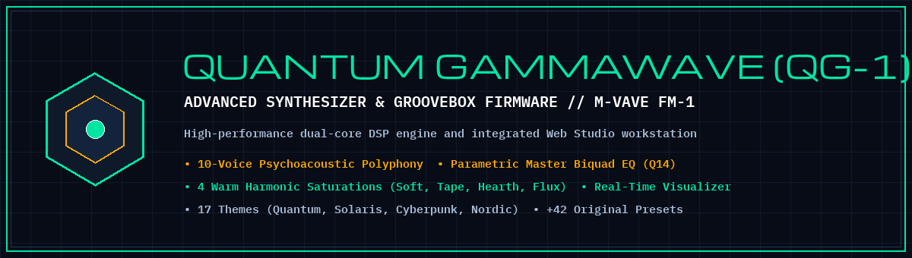
</p>

# QUANTUM GAMMAWAVE (QG-1) — M-VAVE FM-1 Synthesizer & Groovebox Firmware

<p align="center">
  <strong>Advanced Open-Source Firmware & Web Studio for the M-VAVE FM-1 Groovebox (Dual-Core JieLi AC791N SoC)</strong><br>
  <em>10-Voice Psychoacoustic Polyphony · Direct Form II Parametric Master EQ · 4 Harmonic Saturations · 17 Curated Themes</em>
</p>

<p align="center">
  
  &nbsp;&nbsp;
  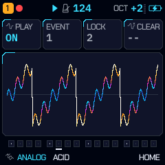
</p>
<p align="center">
  <em>Pantallas reales de Quantum GammaWave (QG-1) en resolución nativa 240×240: a la izquierda, la pantalla principal HOME con analizador de espectro de 28 barras, sol Hearth y curva de filtro en tiempo real en la paleta insignia QUANTUM; a la derecha, el visualizador nativo de audio a pantalla completa (HOME -> HOME) con osciloscopio sincronizado por cruce por cero y órbitas Lissajous.</em>
</p>

**Quantum GammaWave (QG-1)** is an independent, advanced open-source custom firmware and Web Studio workstation engineered specifically for the **M-VAVE FM-1 multitrack FM synthesizer and groovebox** (powered by the dual-core JieLi AC791N SoC). It delivers expanded 10-voice polyphony with psychoacoustic voice stealing, an expanded warm harmonic distortion suite, full-screen audio visualization, fixed-point parametric master EQ, real-time diagnostic telemetry, 17 curated visual themes, and an extensive preset sound library.

[](https://guillel51.github.io/Quantum-GammaWave/)
[](https://guillel51.github.io/Quantum-GammaWave/webapp/editor/)
[](https://guillel51.github.io/Quantum-GammaWave/webapp/installer/)
[](LICENSE)

> **Quantum GammaWave (QG-1)** is dedicated firmware and workstation software engineered specifically for the M-VAVE FM-1 groovebox hardware.
> - **Official Project Portal & Emulator:** <https://guillel51.github.io/Quantum-GammaWave/>
> - **Web Studio Workstation (Editor, Sequencer, Telemetry):** <https://guillel51.github.io/Quantum-GammaWave/webapp/editor/>
> - **USB Web Installer & Safe Flasher:** <https://guillel51.github.io/Quantum-GammaWave/webapp/installer/>
> - **GitHub Repository:** <https://github.com/Guillel51/Quantum-GammaWave>
> - **Official Documentation:** [English Manual (`docs/MANUAL.md`)](docs/MANUAL.md) · [Manual en Español (`docs/MANUAL.es.md`)](docs/MANUAL.es.md)

---

## About Quantum GammaWave (QG-1)

**Quantum GammaWave (QG-1)** is a high-performance, community-driven firmware platform developed for the M-VAVE FM-1 groovebox. Designed to unlock the full potential of the hardware's dual-core JieLi AC791N architecture, Quantum GammaWave pairs an optimized embedded DSP engine with an integrated Web Studio environment for real-time sound design, pattern sequencing, diagnostics, and USB flashing.

While maintaining respect for and full lineage attribution to predecessor projects ([Felucca](https://github.com/hugelton/Felucca), [JIANT FM](https://github.com/juanjiant-bit/JIANT), and [Pocket GammaWave](https://github.com/fvalente/GammaWave-FM1)), Quantum GammaWave stands as an autonomous, self-contained system offering enhanced sonic fidelity, robust voice management, contemporary visual themes, and dedicated workstation tools.

---

## What's in Quantum GammaWave (`v1.4-QG`)

- **10-Voice Polyphony with Psychoacoustic Smart Stealing:** Expanded real-time polyphonic capacity from 8 to 10 voices across tracks. Utilizes psychoacoustic weighted-energy voice allocation to prioritize quiet release tails ($<-40\text{ dB}$) during voice stealing, preventing audible clicks while maintaining real-time DSP stability via dynamic load throttling.
- **Harmonic Distortion & Saturation Suite:** 4 musical, warm saturation topologies with dedicated algorithms:
  - **`SOFT` (Musical Soft Warmth):** Biased tanh soft-clipping with rich 2nd harmonic saturation.
  - **`TAPE` (Tape Warmth):** Smooth cubic polynomial saturation with subtle tape saturation and head warmth.
  - **`HEARTH` (Tube Heat):** Asymmetric tube bias curve with rich sub-bass reinforcement and smooth compression.
  - **`FLUX` (Analog Drift):** Thermal tape flux saturation with subtle bias drift and tape head roll-off.
- **Three Completely New Visual Themes with Exclusive Identities:**
  - **`SOLARIS`:** Radiant solar gold, stellar corona amber, and forge embers on deep charcoal.
  - **`CYBERPUNK`:** High-contrast synthwave neon grid with electric cyan and laser magenta highlights.
  - **`NORDIC`:** Arctic obsidian black with emerald aurora borealis gradients and warm beacon accents.
- **Expanded Sound Library (+42 Original Presets):**
  - Meticulously designed across all synthesis engines into 8 organized musical categories:
    - *Ambient:* Borealis Pad, Cosmic Winds, Polar Aurora, Space Lullaby.
    - *Drones:* Nebula Drone, Abyss Drone, Cyber Drone, Vox Drone, Wraith Drone.
    - *Bells:* Crypt Bell, Temple Bell, Tibet Bowl, Shrine Bell, Chime Tree.
    - *Hurdy Gurdy:* Hurdy Gurdy, Gurdy Drone, Medieval Viel, Gurdy Wheel.
    - *Acoustic & Traditional:* Nordic Organ, Bamboo Flute, Folk Drone, Gothic Shrine.
    - *Ethnic & Experimental:* Sitar Reson, Koto Harp, Gamelan Met, Shaman Chant, Tibetan Vox, Balafon, Ethnic Call.
    - *Evolving Pads:* Wraith Pad, Solaris Glow, Aura Strings, Mystic Choir, Solar Hymn.
    - *Organic Plucks:* Wood Pluck, Harp Pluck, Folk Pluck, Ethnic Pluck.
- **Transient Preset Selection Overlay (PRESET Knob):**
  - Turning the PRESET encoder instantly shows the full 7-row categorized library overlay for 1.5 seconds without interrupting real-time audio playback.
- **Dynamic Modern ARP Visualization:**
  - Real-time 16-step rhythmic pattern trajectory, direction mode visualization (UP, DN, UPDN, CONV, DIVG, CHORD, etc.), octave arcs, swing offsets, and tempo-synced live playhead.
- **GLO 2 System Monitor (Diagnostics & Live Telemetry):**
  - Real-time hardware telemetry: active voice count, track-by-track polyphony distribution (T1–T6), dual-core CPU load and execution ticks (`mc_fx_tk`), DSP buffer integrity, and master bus status.
- **Full-Screen Integrated Visualizer (`HOME -> HOME`):**
  - Tapping HOME while already on the HOME screen opens an immersive, hardware-native audio visualizer featuring harmonic oscilloscope traces, dynamic Lissajous phase orbits, and real-time audio telemetry, returning cleanly with a single press.
- **Direct Form II Transposed Biquad Filter Engine (Peak/Bell & Notch):** Fixed-point Q15 parametric EQ filters for precise surgical tone sculpting and master channel resonance cleanup.
- **Visual Diagnostics & Virtual Device Simulator:**
  - Fallback virtual device simulator for Web Studio and WebAssembly emulator when physical hardware is disconnected or WebMIDI permissions are missing.
  - Diagnostics modal providing instant connection troubleshooting, SysEx logging, and MIDI port state inspection.
- **Quantum GammaWave HUD** on the FM-1's 240×240 screen, in the GAMMA palette (default), plus THERMAL and WRAITH palettes:
  - **HOME**: the selected track's filter response curve drawn over a 28-bar audio-reactive spectrum display, the Hearth sun with an orbiting moon, and the T1–T6 track strip.
  - **EDIT pages**: two live scope traces above the **Wraith ribbon** — six zones (`FLU` · `WHI` · `VOX` · `CHR` · `BEL` · `SCR`) whose needle follows the filter cutoff (and the filter LFO). With the VOWEL or SCREAM filter, or the VOICE engine, the ribbon shows the vowels `OO` · `OH` · `AH` · `EH` · `EE` instead.
  - Boot splash and updated ABOUT page with system metrics and credit lineage.
- **49-genre song generator (GEN)** — open it with **`[OCT−] + [PLAY]`**, or turn **SELECT** on HOME. Page 1: **KNOB 1** genre, **KNOB 2** seed, **KNOB 3** energy, **KNOB 4** form (LOOP / PARTS / SONG); **SELECT** turns the five pages (drums, bass, chords, arp; lead, complexity, swing, humanize; SONG: tempo, key, scale, length; FEEL: space, fills, wet, grit); **ALGORITHM** gives the piece new instruments (the notes kept); **OCT+** makes the piece, **PLAY** auditions it, **HOME** closes. The piece playing is **NOW**: every change shapes NOW (on the next bar while playing) and **SAVE keeps it as a take** — the **TAKES** reel (**PRESETS**) holds only the takes you saved (32, kept over power-off): scroll it (round) and the take under the cursor plays on the next bar (OCT+ or PLAY when stopped); there **KNOB 1–3** are the tempo, key and energy, **KNOB 4** picks a section, **EDIT** deletes, **OCT−** goes back. **GLO + G4 / A4** step NOW back and forward. Hold **OCT+** and the whole screen maps the keys: remake one part, one sound, one section, the harmony, the mix, **drop a part while held**, **C#5** back to the original take, **D#5** **JAM** (NOW changed by itself every few bars), **F#5** the **share code** (**OCT+ + SAVE** types one in). Hold **OCT−** and the white keys **play takes 1–16** on the next bar; **REC** records them as a **SET**. What a control did shows in a band at the foot of the screen. Genres include:
  - **`TRAP ATL`** (136–150 BPM, half-time bounce, 808 sub, hi-hat rolls and triplets, bell / flute / key melodies)
  - **`UK DRILL`** (140–145 BPM, 3-3-2 hi-hat gallop, late snare, sliding 808, dark strings and choirs)
  - **`DARK TRAP`** (130–148 BPM, Memphis-style cowbell, clipped 808, phrygian bells)
  - **`RAGE TRAP`** (140–160 BPM, Whole Lotta Red or MUSIC flavour: square video-game leads or wobbling stabs, a crushed 808)
  - plus `GAMMAWAVE`, `WRAITHWAVE`, house, techno, trance, electro, EBM, synth pop, darkwave, post punk, motorik, funk, disco, boom bap, UK garage, dubstep, breaks, drum & bass, dub, jazz, bossa, afrobeat, ambient, neo-classical, soundtrack, IDM and more.
  - Pieces are 32 or 64 steps (2 or 4 bars per section) depending on the genre's chord rhythm.
- **One-press MUTATE** — **`[OCT−] + [ENV]`** jumps to **SEQ > MUTATE**. If MUTATE was off on the track it switches it on with SOUND every 2 bars, PATTERN every 4 bars and AMOUNT ≈ 50 %:
  - **`ORBIT`** (the default) mutates notes and timbre while pulling back toward the original pattern; **`DRIFT`** keeps wandering. Intervals: 1, 2, 4, 8, 16 or 32 bars.
  - On the MUTATE page **OCT−** freezes the current mutation and **OCT+** keeps it as the new pattern.
- **Hearth macros** — **`[OCT−] + [ARP]`** steps through six drive/filter macros (`1/6 HEARTH GRAVITY` … `6/6 SOLAR ECLIPSE!`); macros 4–6 switch the filter to SCREAM or VOWEL, and 6 also raises the master DUCK and PUNCH. `[OCT−] + [GLO]` takes a macro back.
- **Hidden visualizer** — **`[OCT−] + [HOME]`** (or MENU > ABOUT, then OCT+): four animated scenes, `1/4 SUPERNOVA`, `2/4 WRAITH 3D`, `3/4 WARP TUNNEL`, `4/4 MATRIX FFT`, which pulse while the sequencer plays. **OCT+** (or PRESETS / ALGORITHM) changes scene, **OCT−** leaves.
- **Web Studio** (browser, [webapp/editor](https://guillel51.github.io/Quantum-GammaWave/webapp/editor/)) — edits the FM-1 live over Web MIDI, or runs on its own in simulator mode:
  - four instant demo songs and its own 49-genre generator (the same genre list; its patterns are generated in the browser and won't match the device's for the same seed);
  - **4 tape lanes (T1–T4)**: DUMP a track's pattern into a lane, layer and bounce lanes, mute and clear them — they hold note patterns, not recorded audio;
  - **EXPORT .WAV**: renders the current song and the tape lanes to a 16-bit **44.1 kHz** stereo WAV for your DAW;
  - the Wraith bar (six zone buttons, a 0–127 slider, or drag on the LCD) and SEQ MUTATE (MUTATE NOW, ORBIT, DRIFT, AMOUNT, FREEZE, KEEP ANCHOR).

---

## The `[OCT−]` shift deck

Hold **`[OCT−]` on its own first**, then press the second button. (A plain OCT− tap still lowers the octave; the octave is put back when a shortcut fires.) The deck works from HOME and the parameter pages — not inside menus or dialogs, and not on pages where OCT− has its own job (on MUTATE it is FREEZE).

| Shortcut | Action |
| :--- | :--- |
| **`[OCT−] + [ARP]`** | Next of the 6 Hearth macros (drive type and amount, cutoff, resonance, filter type) on the selected track |
| **`[OCT−] + [PLAY]`** *(or `[REC]`)* | Open the 49-genre generator (GEN) |
| **`[OCT−] + [ENV]`** *(or `[SCL]`)* | Jump to SEQ > MUTATE (switches MUTATE on if it was off) |
| **`[OCT−] + [HOME]`** *(or `[SAVE]`)* | Open the visualizer |
| **`[OCT−] + [SEQ]`** | Dice the selected track's sequence |
| **`[OCT−] + [EDIT]`** | Dice the selected track's sound |
| **`[OCT−] + [FX]`** / **`[OCT−] + [LFO]`** | Dice the track's FX / LFO |
| **`[OCT−] + [GLO]`** *(or `GLO + G4`)* | Undo; again: redo |

The editing actions ask you to stop the song chain first (`STOP TO EDIT`), as their GLO-layer versions do.

**Selecting tracks:** turn **ALGORITHM** to select T1–T6 from any page. Tap **EDIT** repeatedly to step through the engine's pages: EDIT 1 → EDIT 2 → (MORPH, RETRIG or the FM6 operator pages, depending on the engine) → FILTER → VOICE.

---

Full user manual: **[English (`docs/MANUAL.md`)](docs/MANUAL.md)** · **[Español (`docs/MANUAL.es.md`)](docs/MANUAL.es.md)**. Chapter 17 of the manual gathers the QG-1 additions (the shift deck, the Hearth macros, GEN, the new filter and drive types, the screens and the visualizer).

---

## Real Hardware Interface Gallery

All screenshots below represent the authentic, native 240×240 procedural interface rendered directly by the Quantum GammaWave (QG-1) firmware engine on the M-VAVE FM-1's color display.

### 1. Quantum Signature Suite & Core Views

| HOME Screen (Spectrum & Hearth Sun) | EDIT 1 (Wraith Cutoff Ribbon) | FM6 Operator Algorithms | Master Mixer (6 Tracks) |
| :---: | :---: | :---: | :---: |
|  | 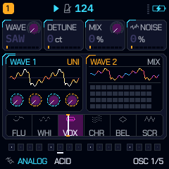 | 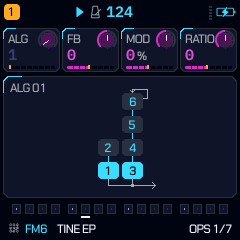 | 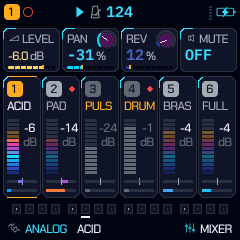 |
| *Real-time 28-bar spectrum & filter curve* | *Dual VA oscillators & spectral ribbon* | *32 DX7-style FM operator networks* | *Levels, pan, peak meters & sends* |

| Full-Screen Audio Visualizer (`HOME -> HOME`) | Parametric Master Biquad EQ | GLO 2 System Telemetry | Transient Preset Browser (1.5s) |
| :---: | :---: | :---: | :---: |
|  | 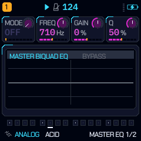 | 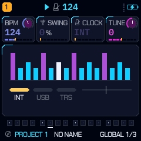 | 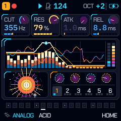 |
| *Zero-crossing scope & Lissajous orbits* | *Direct Form II Transposed Peak/Notch EQ* | *Active polyphony & dual-core CPU ticks* | *Fast 7-row categorized library overlay* |

### 2. Performance, Sequencing & Drum Synthesis

| Dynamic Modern Arpeggiator | DRUM-X Synthesized Pads | Playable Punch-In FX Grid | Motion Sequencer (MSEQ) |
| :---: | :---: | :---: | :---: |
| 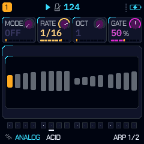 | 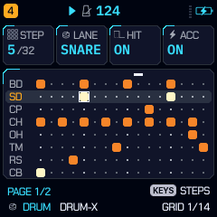 | 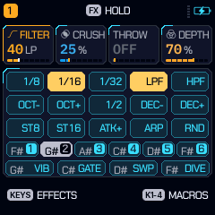 | 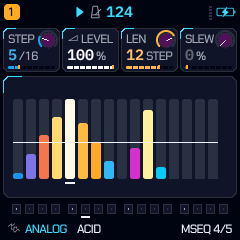 |
| *16-step trajectory, direction & swing* | *8-pad synthesized percussion with morph* | *Quantized live performance repeats* | *Continuous parameter lane automation* |

| Step Sequencer | Piano Roll Playhead | Hearth Macros Layer | Harmonic Performance Mode |
| :---: | :---: | :---: | :---: |
| 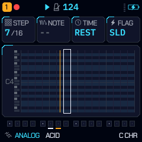 | 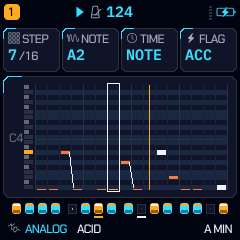 | 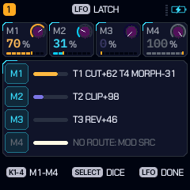 | 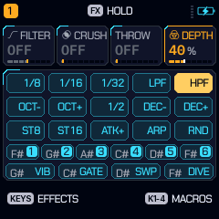 |
| *Velocity, microtiming & parameter locks* | *Active note trajectories & ties* | *Expressive drive & filter macro shifts* | *Live scales, chords and filter curves* |

### 3. Curated Visual Themes

| QUANTUM (Signature) | SOLARIS (Solar Gold) | CYBERPUNK (Neon Grid) | NORDIC (Obsidian Aurora) |
| :---: | :---: | :---: | :---: |
|  | 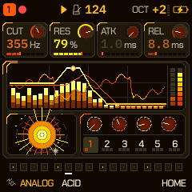 | 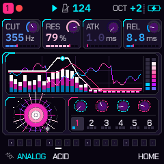 | 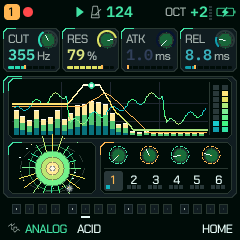 |
| *Deep quantum indigo & Cherenkov cyan* | *Radiant gold, ember & corona amber* | *High-contrast synthwave magenta/cyan* | *Arctic emerald gradients on obsidian* |

---

## Synthesis engines & sound architecture

### 1. Eight synthesis engines (no samples)
- **`ANALOG`**: dual virtual-analog oscillators (`SAW`, `SQR`, `TRI`, `SIN`, `PWM`, `SYNC`, `RING`, `SAW3`, and the dirty sines `TUBE` — GammaWave's Hearth tube curve — and `FOLD` — WRAITH's Blast wavefolder — whose amount is MORPH plus ENV/LFO → SHAPE) with interval (`INT ±24 st`), detune, oscillator mix and noise, through the track filter (`CUT`, `RES`, `DRIVE`).
- **`FM6`**: 6-operator DX7-style FM (DX7 `.syx` voices load through the Web Studio), the 32 algorithms drawn on screen, per-operator editing on the device (`OPERATOR`, `OP ENV`, `OPERATOR 2`) and a 32-voice user bank (`B1–B32`; until you send one, `B1–B11` hold built-in default keys: electric pianos, bells, mallets, pads).
- **`PHASE`**: CZ-style phase distortion with feedback (`FB`), from warm brass to digital growl.
- **`LOFI`**: 1-bit, 4-bit and 8-bit chip voices plus 32-formula **Bytebeat (`BYTE`)** and **Floatbeat (`FLOAT`)** engines tuned to the keyboard scale.
- **`VOICE`**: formant voice (`VOWEL`, `VOWEL2`, `TALK`, `SHIFT`, `BUZZ`, `BREATH`) — its EDIT page shows the vowel ribbon.
- **`WHEEL`**: tonewheel drawbar organ with rotary speaker, key click and harmonic percussion.
- **`NOISE`**: tuned and free-running resonant / metallic noise for risers, snares and industrial textures.
- **`DRUM`** (the DRUM-X kits): 8 synthesized pads (`BD`, `SD`, `CP`, `CH`, `OH`, `TM`, `RS`, `CB`) with A/B kit morphing (`MORPH`), wavefolder (`FOLD`), `FM ENV`, an 808 long pitch-drop mode (`PMOD LONG`) and tempo-synced `X-MOD`.

### 2. Filters and the Wraith ribbon (`EDIT > FILTER`)
Every track's filter offers `LP`, `HP`, `BP`, `COMB`, `VOWEL` (a state-variable filter blending low-pass, band-pass and a saturated notch for a vocal colour) and `SCREAM` (a state-variable filter with a saturated integrator, for screaming resonance). The **Wraith ribbon** labels the cutoff range with six zones (**`FLU` · `WHI` · `VOX` · `CHR` · `BEL` · `SCR`**); turning CUT sweeps the needle across it.

### 3. Punch-in FX, slicer, 5 reverbs & master bus
- **Playable punch-in FX (`FX` held + keys)**: quantized performance effects (`REPEAT 1/8 · 1/16 · 1/32`, `LPF`, `HPF`, `OCT-/+`, `1/2 TEMPO`, `DEC-/+`, `STUTTER 1/8 · 1/16`, `ATK+`, `ARP`, `RANDOM`), recordable into a 4-bar automation lane per section.
- **5 reverb models**: `ROOM`, `SPRING`, `SHIMR` (octave-up shimmer), `RESO` (4 scale-tuned sympathetic strings) and `CLOUD` (pitch-granulated freeze wash).
- **Master bus (`FX > MASTER`)**: `CLIP` (level-compensated soft clipper), `PUNCH` (drum transient saturator), `DUCK` (kick-triggered sidechain pump) and an always-on 2:1 auto-leveler.

### 4. Dual-core audio engine (JieLi AC791N)
Some synth tracks run on the FM-1's second core, with per-block checksums and a watchdog. If the second core ever faults, the firmware shows a notice and stays on one core until power-off. Hold **`REC`** at power-on to force single-core mode.

---

## Installing on M-VAVE FM-1 hardware

> **(QG-1)** Web installer with SHA-256 check, pre-flight checklist, *verify only* and an automatic backup over
> GammaWave/JIANT; one-click launchers in `tools/install/` (`install-fm1.sh`, `.command`, `.bat`); CLI `tools/fm1_install.py
> --verify-only / --sha256`. Recovery guide (es): [docs/INSTALL.es.md](docs/INSTALL.es.md). Emulator while coding:
> `python3 tools/emu_dev.py` (rebuilds on every change and reloads the page).

1. **Open the USB web installer** in Chrome, Edge or Opera (it needs Web MIDI):
   **<https://guillel51.github.io/Quantum-GammaWave/webapp/installer/>**
2. Connect the **M-VAVE FM-1** with a USB data cable and switch it on.
3. **Coming from another custom firmware (Felucca, baudgirl, etc.)?** Click **Return to official V15 first** (which also backs up your flash), then click **Install**.
4. **Coming from official V15, JIANT, or earlier firmware?** Click **Install** directly. Don't unplug the cable until flashing completes.

*Quantum GammaWave uses the FM-1's user sample flash (`USR1–3`) to store 8 multi-section songs and the 32-voice FM6 user bank. Back up any custom WAV samples from stock firmware before flashing.*

You can also download the package from the **[Releases page](https://github.com/Guillel51/Quantum-GammaWave/releases)** (named `felucca-<version>.fwsc`, e.g. `felucca-v1.4-QG.fwsc` — the build tooling keeps Felucca's file name).

---

## Building from source

See **[BUILDING.md](BUILDING.md)** for the toolchain (JieLi clang, the AC79 SDK files) and the options:

```bash
./build.sh                                                       # build/felucca.fwsc (needs JIELI_TOOLCHAIN and AC79_SDK)
sh web/emu/build.sh                                              # the WebAssembly emulator in build/emu (needs emcc)
python3 web/make_site.py build/felucca.fwsc v1.4-QG build/site   # the Web Studio + USB installer
```

On Windows, `tools/build_windows.py` drives the same build inside WSL2 Ubuntu (edit its toolchain paths first).

---

## Changelog

### `v1.4-QG` / `v1.5-QG` — Quantum GammaWave Major Release
- **10-Voice Psychoacoustic Polyphony:** Expanded real-time capacity from 8 to 10 voices across tracks with weighted-energy quiet-tail stealing ($<-40\text{ dB}$) and dynamic load throttling.
- **Harmonic Distortion Suite:** 4 distinct saturation topologies (`SOFT`, `TAPE`, `HEARTH`, `FLUX`) with dedicated DSP curves in `firmware/src/fx.c`.
- **Parametric Master EQ Engine:** Fixed-point Q14/Q15 biquad Direct Form II Transposed filters providing surgical Peak/Bell boost and Notch cleanup.
- **Visual Themes Suite:** 17 themes including exclusive additions `SOLARIS`, `CYBERPUNK`, `NORDIC`, and `QUANTUM`, fully synchronized across firmware and Web Studio.
- **Expanded Sound Library:** +42 original presets structured across 8 musical categories (Ambient, Drones, Bells, Hurdy Gurdy, Acoustic & Traditional, Ethnic & Experimental, Evolving Pads, Organic Plucks).
- **Original Drum-X Kits:** Added `QUANTUM BEAT`, `HEARTH KIT`, and `CYBER DRUM` kits to the DRUM synthesis engine.
- **Full-Screen Audio Visualizer (`HOME -> HOME`):** Integrated real-time hardware oscilloscope, phase orbits, and audio telemetry accessible directly by tapping HOME.
- **Transient Preset Browser:** 1.5-second non-blocking 7-row categorized library overlay activated by turning the PRESET encoder.
- **GLO 2 System Telemetry:** Live monitoring for active voice count, per-track polyphony distribution (T1–T6), dual-core execution load (`mc_fx_tk`), and master bus integrity.
- **Dynamic Modern ARP Visualizer:** Real-time 16-step rhythmic trajectory, direction visualization, swing offsets, and tempo-synced playhead.
- **Web Studio & Emulator Upgrades:** Seamless offline simulator fallback, enhanced connection diagnostics, SysEx logging, and responsive audio telemetry.

### `v1.3-QG` — Audio Engine & Telemetry Enhancements
- **CHORUS > TYPE PHASER:** Four swept all-passes on chorus bus with persistent project state storage.
- **Stabilized DRUM Render Output:** Modularized `drum_out` and `drum_add` stages reducing cycle overhead while preserving bit-identical audio output.
- **QUANTUM Visual Palette:** Added deep quantum indigo and Cherenkov cyan visual palette.
- **Deterministic Randomization Checks:** Enhanced DICE ALL engine verification ensuring balanced timbre evolution across multi-track throws.
- **Platform Hardening:** Added offline WebAssembly emulator fallback for non-Chromium and WebMIDI-restricted environments.

---

## Credits & license

**Quantum GammaWave (`QG-1`)** is free and open-source software released under **[GPL-3.0-only](LICENSE)**.

Built upon the work of:
- **Pocket GammaWave (GW-1)** by Leo Kuroshita / Hügelton Instruments & ShadowTune.
- **[Felucca](https://github.com/hugelton/Felucca)** by [Hügelton Instruments](https://hugelton.com) (Leo Kuroshita, [@kurogedelic](https://github.com/kurogedelic)) — core FM-1 hardware abstraction, bootloader, engines, and the [Fukiai](https://github.com/hugelton/Fukiai) icon font ([MIT](LICENSES/MIT-Fukiai.txt)).
- **[JIANT FM](https://github.com/juanjiant-bit/JIANT)** — DRUM-X synthesis engine, dual-core audio scheduler, procedural generator foundation, and thermal font pipeline.
- **[SLOOP](https://github.com/isod89/sloop-fm1)** by isod89 — multi-section song arranger and live `SONG REC` architecture.
- **[Melodee](https://github.com/keremimo/melodee)** (keremimo) & **[fm1-x0x](https://github.com/charlesvestal/fm1-x0x)** (Charles Vestal) — AC791N second-core startup, memory-read guard, and WebAssembly browser emulator architecture.
- **DSP & fonts**: `msfa` 6-op FM from [Dexed](https://github.com/asb2m10/dexed) ([Apache-2.0](LICENSES/Apache-2.0-msfa.txt)); formant synthesis after [klattsch](https://github.com/tgies/klattsch) (MIT); [Chakra Petch](LICENSES/OFL-ChakraPetch.txt), [IBM Plex Mono](LICENSES/OFL-IBMPlexMono.txt), [Michroma](LICENSES/OFL-Michroma.txt), and [DotGothic16](LICENSES/OFL-DotGothic16.txt) (SIL OFL 1.1).

*M-VAVE and FM-1 are trademarks of their respective owners. Quantum GammaWave is an independent open-source project and is not affiliated with or endorsed by M-VAVE or Hügelton Instruments.*
