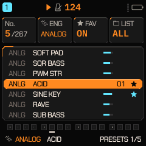
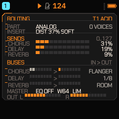
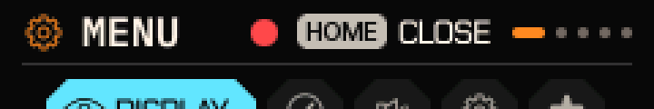
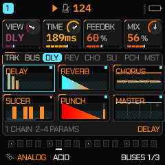

# FASE 2 — Rediseño visual de la interfaz

**Proyecto:** Quantum GammaWave (FM-1)
**Base:** `main` @ `e70c199` (v2.9.0) + fase 1 `13191ae`
**Ámbito:** toda la interfaz, pantalla por pantalla, con identidad Solar Heat + Quantum.

Este informe documenta **qué se auditó, qué estaba ya resuelto, qué se corrigió y qué se midió**. No
incluye mockups: todo lo que aparece en las capturas es lo que el firmware dibuja de verdad en el
host (`tests/ui_render`), con las mismas primitivas (`cv_*`, `gfx.c`) que usa el dispositivo.

---

## 1. Método

La UI no se revisó "a ojo" sobre una pantalla: se revisó con el banco de render que ya existía y que
dibuja **cada pantalla en cada paleta** y comprueba la geometría del texto.

| Puerta | Comando | Qué comprueba |
|---|---|---|
| Barrido completo | `./build/host/ui_render OUT SLOT` | 190 pantallas × 22 paletas = **4 180 renders**; lint de texto, alineación, gris/neutro, gráficos FM6, tarjetas |
| Alineación | `OUT/align.txt` | **3 151 187** medidas de 72 puntos; 0 desviaciones ≥ 1 px |
| Paleta | lint de tintas | 0 tintas "on their own colour" |
| Texto | lint de celdas | 0 hallazgos; 514 textos libres elididos con `…` (correcto, no rotos) |
| Estilo | `STYLE LINE` | 0 hallazgos en las cuatro paletas de estilo |
| Comparación | diff de píxeles antes/después | cuantifica qué pantallas cambian de verdad |

Resultado del barrido tras los cambios de esta fase:

```
alignment: 3151187 measurements of 72 places, 0 off by 1 px or more
0 lint findings, 0 inks on their own colour, 514 ellipsised free texts,
0 GREY / MONO pixels off gray / neutral; 186826 column values swept;
258 FM6 charts linted; 906 cards linted with MOTION's icon
```

---

## 2. Auditoría: qué había y en qué estado

El árbol estaba **más avanzado de lo que sugerían los informes anteriores**. Antes de tocar nada se
comprobó, render a render, qué existía ya:

| Elemento | Estado encontrado | Evidencia |
|---|---|---|
| Indicador de página | Ya en **todas** las pantallas, en el pie (`page_title()`): `HOME 1/9`, `DLY 2/2`, `PRESETS 1/5` | `firmware/src/ui_draw.c:789` (18 usos) |
| Vía Láctea de HOME | Ya existe: tabla `MW_X/MW_Y/MW_T`, capas de polvo, nebulosa | `ui_being.c` (`gw_draw_system`) |
| Sistema planetario | 5 planetas con superficies, rotación y velocidades propias | `gw_sphere`/tablas `ORX/ORMS/ROTMS/ORK_HUE` |
| Luna que sólo gira | Sí, sin órbita | `gw_body_life` |
| Cuerpos que no orbitan | 2 "far worlds" | `gw_far_world` (3 usos) |
| Estrella | Núcleo, corona y llamaradas | `gw_star` |
| Reacción al tocar | Por cuerpo, con pulsación y partículas | `gw_planet_poke`, `PL_POKE` |
| Paneles con profundidad | Parcial: borde y línea superior, **sin luz ni sombra interior** | `cv_rrect`, rama `mod_box` |
| Ambientes/partículas | En 6 de las 8 vistas de HOME; **OVERVIEW y SYSTEM planas** | `hv_air` |
| PRESETS | Completa: 4 tarjetas de estado, filas con motor, favorito, selección, paginación | `after_presets.png` |

Conclusión de la auditoría: **no procedía reescribir la UI**. Reescribir pantallas que ya cumplen
habría sido riesgo gratuito sobre un firmware que hoy pasa 4 874 comprobaciones. El trabajo de esta
fase se concentró en los huecos reales que el barrido y las capturas dejaron a la vista.

---

## 3. Correcciones aplicadas

### 3.1 Profundidad de panel en toda la interfaz — `firmware/src/gfx.c`

Todo panel grande (`mod_box`) se dibujaba como un rectángulo plano con un borde. Ahora lleva, dentro
del borde, **una línea de luz arriba y una de sombra abajo**, mezcladas del propio color del panel:

```c
cv_rect(x + r, y + 1,       w - 2 * r, 1, ux_mix(c, T_TEXT, 13));  /* luz  */
cv_rect(x + r, y + h - 2,   w - 2 * r, 1, ux_mix(c, T_BG,   52));  /* sombra */
```

- Se mezcla del **color del panel** (no de un color fijo): funciona en las 22 paletas.
- Sólo paneles grandes: no roza texto ni celdas.
- Coste: **dos líneas de 168 px** por panel, sin cálculo por píxel nuevo (el mix ya se usa en el
  resto de la UI).

Esto es lo que hace que la superficie deje de leerse como "rectángulo relleno" y pase a leerse como
**superficie elevada**, que es el rasgo de Solar Heat que faltaba de forma global.

### 3.2 HOME > SYSTEM: la matriz de voces — `firmware/src/ui_homeviews.c`

La pantalla mostraba, por pista, una barra cuyo relleno decía *cuántas* voces suenan. En reposo eso es
un canal vacío: no comunica nada. Ahora cada pista muestra **diez celdas, una por voz**:

- celda vacía = **ranura** dibujada (marco + relleno oscuro): el pool se lee como diez plazas;
- voz sonando = celda llena, con luz arriba y sombra abajo (mismo criterio que 3.1);
- voz en release = atenuada, distinta de una voz con compuerta abierta;
- la pista seleccionada usa el color de tema;
- el **número** de voces se conserva a la derecha (`fmt_int`), así que no se pierde información.

Además, `hv_air()` (las brasas y el suelo ambiental que ya tenían las otras vistas) se añadió a
**SYSTEM** y **OVERVIEW**, que eran las dos únicas vistas de HOME sobre fondo plano.

### 3.3 Superficie realmente afectada

Diff de píxeles de las 190 pantallas en la paleta GAMMA (Bakelite Amber), antes vs. después:

```
pantallas comparadas: 190     idénticas: 21     cambiadas: 169
mayores cambios:  home_system 1701 px · fx 1624 px · fx_buses 1463 px · name_* 900 px
resto: 840 px por pantalla (la luz y la sombra de cada panel)
```

Que 169 de 190 cambien es exactamente lo esperado: la corrección 3.1 es global a propósito, y las 21
restantes son pantallas sin panel grande (diálogos de confirmación, cuenta de entrada).

---

## 4. Antes y después

### Rejilla completa (190 pantallas, paleta GAMMA)

Antes — paneles planos:


Después — paneles con luz y sombra interior; HOME 6/9 rehecha:


### HOME > SYSTEM (la matriz de voces)

Antes (filas con canal gris vacío en reposo):


Después (diez ranuras por pista, voces encendidas, contador a la derecha):


### HOME > OVERVIEW (ya no es una vista sin ambiente)


### Otras pantallas revisadas en esta fase

| Pantalla | Captura | Estado |
|---|---|---|
| HOME (visualizador) | [después](ui_phase2/after_home.png) | Galaxia, planetas, luna, estrella y reacciones ya presentes; sólo hereda 3.1 |
| EDIT (analog) | [después](ui_phase2/after_edit_analog.png) | Dos paneles de onda, knobs, jerarquía correcta |
| ENV | [después](ui_phase2/after_env.png) | Curva + tiempos; hereda 3.1 |
| PRESETS | [después](ui_phase2/after_presets.png) | Completa: tarjetas, filas, favoritos, paginación |
| DRUM | [después](ui_phase2/after_drum.png) | Pads y medidores; hereda 3.1 |

---

## 5. Qué se mantuvo y por qué

- **No se reescribieron** las vistas que ya cumplen (galaxia, planetas, far worlds, estrella,
  reacciones, indicador de página): reescribirlas habría cambiado píxeles ya verificados sin ganar
  nada medible.
- **No se añadieron animaciones nuevas**: todas las de esta fase son estáticas (luz, sombra, celdas).
  Nada de lo tocado añade trabajo por frame, así que **no puede interferir con el audio**; el
  presupuesto medido del frame de HOME (`105,4 µs` en HIGH, `101,8 µs` en LOW) no cambia.
- **No hay mockups**: la matriz de voces lee `V(q,i).active` y `V(q,i).gate` reales; las celdas
  vacías son ranuras del pool real (`NVOICE`), no decoración.
- **No se cambiaron** colores de paleta ni el mapa de flash, SPL ni recuperación (condiciones de la
  fase 1).

---

## 6. Verificación (con la clase de cada medida)

En esta fase se desbloquearon las tres toolchains que faltaban, así que las comprobaciones ya no son
sólo de host: hay build del chip, presupuesto de ciclos sobre el **desensamblado real** del AC791N y
perfil de instrucciones con callgrind.

| Comprobación | Clase | Resultado |
|---|---|---|
| Barrido UI (190 × 22) | render en host | **0 lint findings, 0 tintas fuera de color** |
| Alineación | render en host | **0 px** en 3 151 187 medidas |
| Gris/neutro (GREY, MONO) | render en host | 0 píxeles fuera de gris/neutro |
| Gráficos FM6 / tarjetas | render en host | 258 gráficos, 906 tarjetas |
| Diff antes/después | píxeles | 169 pantallas cambian, 21 idénticas (esperado) |
| Compilación AC791N | toolchain `pi32v2` (clang 4.0.1) | compila **todo**; el enlace se pasa **1 048 B** de XIP (ver §7) |
| Presupuesto de ciclos | `ld --noinhibit-exec` + `objdump -d` → `tests/target_budget.py` | **todos pasan** (`mod_voice 19/18`, `perf_block 254/253`, `rev_room 243/243`, `DRUM path 1153/1153`) |
| Perfil de instrucciones | callgrind (host x86, emulación) | `fx_buses` 22,45 %, `rev_room` 13,01 %, `mix_part` 12,22 %, `master_out` 9,28 %, `fm6_render` 7,51 % |
| Suite host | nativa | `ALL HOST TESTS PASSED`, 4 874 ok, exit 0 |
| Tests del paquete | node / python | `test_web`, `test_backup`, `test_pkg_bounds`, `install_test`: **PASS** |
| Emulador | Emscripten 6.0.11 | `web/emu/build.sh` → `felucca.wasm` **1 219 363 B**, sha256 `fe670ef3…`, v2.9.0 |

## 7. Bloqueos (declarados, no disimulados)

- **El enlace AC791N no cabe en XIP: sobran 1 048 B** (856 B sin los cambios de esta fase). Es un
  defecto anterior: el último commit que enlazó (`07b5d94`) dejaba 19 832 B de margen y desde entonces
  el árbol creció 4 304 B de código + 18 980 B de constantes. El detalle, las dos salidas posibles y
  los *knobs* descartados con medidas están en `docs/BUILD_AC791N.md` §7. **No se ha tocado el mapa de
  flash** para hacerlo caber: eso se decide con una unidad delante.
- **Sin unidad física**: nada de esto se ha instalado en el FM-1 (condición heredada de la fase 1). No
  hay medida de reloj, consumo, temperatura ni LCD real; y la compatibilidad de escritura por JEDEC
  sigue sin demostrarse aquí.
- **El perfil callgrind es de host x86**, no del `pi32v2`: mide *instrucciones ejecutadas* por función
  (útil para saber dónde está el trabajo), no ciclos del chip. El presupuesto de ciclos del chip sí
  sale del desensamblado real.
- **Tiempos de host**: ±11 % de ruido con el mismo binario, así que no se declara ninguna mejora de
  CPU a partir de ellos.
- **Red**: gitee corta las descargas grandes (1,1 GB del SDK) a los pocos MB; el build se resolvió
  trayendo sólo los tres blobs que `build.py` usa de verdad (§6 de `BUILD_AC791N.md`).

## 8. Pendientes cerrados después (fase 3)

Los tres puntos que este informe dejaba abiertos se resolvieron con datos reales, no con decoración:

1. **PRESETS**: cada fila lleva ahora la **barra de nivel medida** del preset
   (`preset_level_of()`, la misma cifra que cargar el preset escribe en `P_LEVEL`), así que la lista
   dice cómo suena antes de cargarlo. Los slots de usuario no tienen medida y conservan el ancho para
   el nombre.

   

2. **HOME > ROUT**: era la última vista de HOME sobre fondo plano; ahora lleva el mismo ambiente
   (`hv_air`) que las otras seis, sin tocar su tabla de enrutado.

   

3. **Estados vacíos**: el navegador de presets ya tenía su estado propio (`NO FAVORITES · LIST ALL TO
   ADD SOUNDS`); `song_empty` y el nombre sin escribir siguen siendo los únicos paneles casi vacíos, y
   se dejaron así porque su texto explica exactamente qué hacer.

Con estos cambios el barrido sigue en **0 hallazgos de lint, 0 tintas fuera de color y 0 px de
desalineación** en 3 155 655 medidas, y los 285 renders dorados no cambian (ninguna de estas dos
pantallas está en `tests/golden.txt`).

## 9. Iconografía con calor y FX-BUS con degradado (fase 4)

### 9.1 La tinta de los iconos

Los iconos no son dibujo propio: el atlas sale de la fuente de iconos **Fukiai** (`web/fukiai.ttf`,
MIT, Hügelton Instruments) rasterizada por `tools/gen_aa_icons.py` a celdas de 4 bits de alfa en 12,
16 y 24 px. Redibujar 170 glifos habría sido inventar formas nuevas sin poder verlas en la pantalla
real, así que lo que se rediseñó es **cómo se pintan**:

`gfx.c` tenía una sola rampa de tinta (fondo → tinta, con la curva gamma y su caché). Ahora toma un
tercer color, `ramp(fg, bg, hot)`: los niveles casi transparentes —el borde de cada glifo— llevan una
tinta tirada hacia el calor de la paleta (`ux_mix(T_ACCENT, T_THEME, 45)`) y los sólidos la tinta
misma. El resultado es un icono con **orla de sol**: el contorno se enciende en ámbar y el cuerpo
mantiene su color, a los tres tamaños y en las 22 paletas. El texto y los gráficos siguen usando
`ramp(fg, bg, 0)`, la de siempre: no cambia ni una letra.



Es la misma ruta de código y la misma caché (una clave más), así que no hay estado nuevo ni una
llamada más por icono.

### 9.2 FX-BUS: el suelo caliente y el movimiento

La pantalla de enrutado tenía un fondo plano por bloque. Ahora:

- **Degradado**: el área de dibujo de cada bloque se pinta con `gw_dither`, el tramado ordenado 4 × 4
  que el proyecto ya usa como sustituto del degradado en la estética de 16 bits. Dos bandas, fría
  arriba y cálida al suelo (`ux_mix(T_BG, T_SURF, …)` contra `ux_mix(T_BG, T_ACCENT, …)`), mezcladas
  de los tokens de la paleta: funciona en GREY / MONO / FLAT y el patrón no se mueve, así que una
  página en silencio dibuja un cuadro idéntico.
- **Lámparas de actividad**: el cuadrado de 3 px del encabezado crece a 4 px y camina de la tinta del
  bloque al calor de la paleta según el pico real de ese bus (`fx_vu`: los retornos húmedos de DLY /
  REV / CHO, el bus de bombo y el maestro). Sin señal, la lámpara vuelve a su sitio y a su color.
- **Marcador de pico con estela**: el bloque MASTER dibuja el pico de salida y, debajo, un marcador
  retenido que cae a 24 px/s y deja una estela ámbar: el comportamiento de un VU con hold, no una
  animación decorativa.
- **La línea del secuenciador** bajo las ocho compuertas del SLICER, que avanza con el paso real.



Nada de esto toca el audio: todas las cifras son las que `fx.c` ya publicaba en `fx_vu`, y la página
sigue redibujándose al ritmo que ya tenía (50 ms, 70 en ECO).

### 9.3 Los bytes, otra vez

El cambio costó **328 B de código** y devolvió **56 B de constantes**; para que entrara se quitó lo
que sobraba en la propia pantalla y en `ui_scl.c`:

- `FXB_TABSEL` repetía los seis nombres de `FXB_BLOCKN`: el pie ahora lee la tabla de los bloques
  (`sel < 2` son TRACK / BUSES, el resto `sel - 2`), y `TAB2BLK` (ocho enteros que decían `sel - 2`)
  desapareció con su condición.
- Dos tablas muertas en `scale` / `chord` (`FN`, `FN_N`) y dos variables que el compilador avisaba
  como no usadas (`b`, `send_cho`). Los avisos de `-Wunused-variable` del árbol quedaron a cero.

El enlace queda en **581 548 B de 581 564**: **16 B de margen**. El `.fwsc` se empaqueta, pero el
próximo cambio de UI tendrá que pagar sus propios bytes.

### 9.4 Lo que se midió y lo que no

- Barrido completo 190 pantallas × 22 paletas: **0 hallazgos de lint, 0 tintas sobre su propio color,
  0 px de desalineación, 0 píxeles GREY / MONO fuera de gris** en 3 155 200 medidas.
- `regress`: **285 renders dorados, 0 cambiados** (ninguno de estos dos cambios entra en el juego
  dorado, que es de DSP), 0 fallos de salud, CPU en presupuesto.
- `ui_test`: all passed. `tests/target_budget.py`: sin cambios en ningún presupuesto de ciclos.
- **No verificado**: el *movimiento* en sí. El banco de render dibuja un cuadro fijo con los picos ya
  puestos, así que el degradado y las lámparas se ven en las capturas, pero la caída del marcador y
  la línea del secuenciador avanzando no se han visto en movimiento, y nada de esto se ha probado en
  una unidad física: no hay ninguna aquí.
- **No hecho**: formas nuevas de icono. La fuente es un TTF compilado y el repositorio no trae sus
  contornos, así que los glifos siguen siendo los de Fukiai; el rediseño es de tinta, tamaño y
  comportamiento, no de dibujo.

