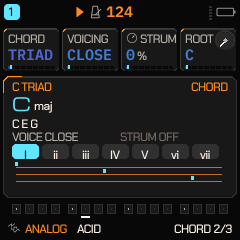
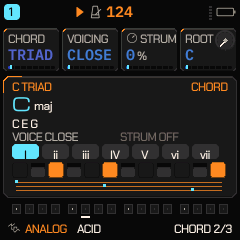
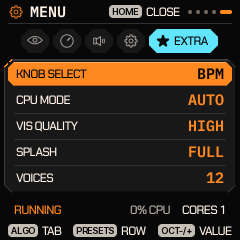

# FASE 3 — Edición musical y modulación avanzada

**Proyecto:** Quantum GammaWave (FM-1)
**Base:** `main` @ `192039f` (fase 2)
**Ámbito:** SC / SCALE / CHORD, voces y polifonía, CPU MODE, LFO y MOD MATRIX.

Todo lo que sigue se midió con el banco de render del repositorio (mismos dibujos que el
dispositivo), con el build del chip y con la suite nativa. **No hay unidad FM-1**: lo que dependa de
tocarla no se declara hecho (§7).

---

## 1. Lo implementado en esta fase

### 1.1 MENU > EXTRA > VOICES: 8 / 10 / 12 voces, 12 por defecto

La polifonía era una constante de compilación (`NVOICE 12`). Ahora hay una **segunda cifra en tiempo de
ejecución** que la recorta sin tocar el almacenamiento:

| pieza | dónde | qué hace |
|---|---|---|
| `voice_ucap` | `core.h` / `voice.c` | 0 = 12 (lo que guarda cualquier ajuste anterior), 1 = 10, 2 = 8 |
| `voice_user_budget()` | `core.h` | la cifra efectiva (8, 10 o 12) |
| `voice_cap()` | `voice.c` | presupuesto compartido por las seis pistas; con LOAD ECO sigue mandando el mínimo |
| `trk_vcap()` | `voice.c` | el tope por pista (POLY/UNISON) también obedece al ajuste |
| `MI_VOICES` | `menu_items.c` | fila en la pestaña EXTRA, valores `8 / 10 / 12` |
| `ui_voices` + `voices_put()` | `ui.c` | el byte del ajuste (`favorites.factory[15][17]`), aplicado en `rp_apply()` |

Decisiones que importan:

- **No cuesta memoria**: `NVOICE`/`VPOOLN` siguen siendo el almacenamiento; bajar a 8 voces no cambia
  `.bss` ni el bucle de render, sólo una comparación.
- **Compatible hacia atrás**: un proyecto o una unidad con ajustes anteriores lee 0 = 12, así que suena
  exactamente igual que antes. No hay migración que hacer.
- **Surte efecto en la nota siguiente**, no al reiniciar: `voices_put()` llama a `rp_apply()`.
- El tope es **global**, no por pista: 10 voces son diez en total (era la confusión fácil de un `POLY`
  por pista).
- Las seis pistas siguen siendo el valor por defecto (era ya el caso: `ui_trks` 0 = seis cuando el
  ajuste es nuevo, y `PREF_SIX` en los antiguos).

### 1.2 CPU MODE aplicado en caliente

Antes el ajuste sólo se leía en `main.c` **antes de arrancar el core 1**, así que cambiarlo no hacía
nada hasta el siguiente encendido y parecía roto. Ahora:

| valor | qué pasa al elegirlo |
|---|---|
| `SAFE SINGLE` | `mc_off = 1` (el bloque siguiente ya renderiza las seis pistas en el core 0) y el core 1 se detiene desde el bucle principal, entre trabajos |
| `DUAL CORE` | se pide el arranque; `cpu_mode_step()` (una vez por frame, nunca en la ISR) lo enciende y sólo entonces `mc_off = 0` |
| `AUTO` | no cambia nada en marcha: conserva la tecla del encendido (REC) como opt-out de la sesión |

Reglas que se mantienen: un core que falló, que no respondió o que se dio por perdido tras un crash
**no se fuerza nunca** (`fm1_mc_barred()`), diga lo que diga el ajuste. La parada va después de que el
core esté entre trabajos, para no cortarlo a mitad de bloque.

### 1.3 CHORD: el acorde sobre las teclas

La página CHORD enseñaba nombre, notas y cuatro carriles con la distribución de las voces, pero el
acorde no se veía como notas en un instrumento (era el hueco que pedía el encargo). Ahora:

- La tira de doce teclas que ya dibujaba SCALE se extrajo a `scl_keys()` (misma primitiva, misma
  geometría) y **CHORD la dibuja con la máscara del acorde**: la fundamental en el acento, el resto de
  los tonos en el tema, el resto de la escala de la tonalidad encendido bajo, y lo demás apagado.
- Debajo quedan los cuatro carriles, comprimidos, que dicen lo que las teclas no pueden: la amplitud
  del voicing (CLOSE apretado, OPEN abierto) y el strum que aplica el motor.
- Todo sale de `chord_from()`/`chord_build()`, las mismas funciones que usa el secuenciador: la página
  no puede enseñar un acorde que el instrumento no toque.

 

### 1.4 EXTRA: el estado en una línea

La pestaña EXTRA enseñaba dos líneas de estado y una de ellas ("CPU MODE: NEXT POWER-ON") caía en el
pie y se solapaba con `ALGO`/`PRESETS` — lo cazó el lint al añadir la fila VOICES. Ahora hay una sola
línea (`RUNNING · CORES n · nn% CPU`) y el aviso desapareció porque **ya no es cierto**: el cambio es
inmediato.

EXTRA con la fila nueva (VOICES 12, el valor de fábrica) y el estado en una sola línea:

---

## 2. SC, SCALE y CHORD: qué había y qué se tocó

La auditoría encontró la sección **más completa de lo que sugería el encargo**, y no se reescribió:

| elemento | estado | evidencia |
|---|---|---|
| Círculo de las doce notas con la tónica arriba, radios a cada grado y anillo | ya existía | `graph_scl_scale` (`ui_scl.c`) |
| Tónica / grados / notas externas diferenciadas | ya existía | acento, tema y `T_DIM` en el círculo y en las teclas |
| Teclado de doce teclas con blancas y negras, notas de la escala y del acorde | existía sólo en SCALE / ahora en CHORD también | `scl_keys()` |
| Indicador de cuántas notas tiene la escala | existía (`n NOTES`) | `graph_scl_scale` |
| Grados con numeral romano, y en escalas que no son de siete su número | existía | `scl_degname()` |
| Calidad del acorde deducida de sus intervalos | existía | `scl_quality()` |
| Voicing y strum representados | existía | carriles de `graph_scl_chord` |
| Ocho progresiones con sus grados, notas y nombre por paso | existía | `PROG_SEQ` / `graph_scl_prog` |
| Indicador de página | existía | pie (`CHORD 2/3`) |

Lo que se corrigió: el acorde ahora **se ve en teclas** (§1.3) y la tira de teclas es una sola
primitiva para las dos páginas (menos código duplicado, misma geometría).

Lo que queda pendiente y es mejora, no defecto: comparar dos escalas lado a lado, escuchar la escala
o el acorde con una tecla dedicada, e indicar la octava/registro de la tira (hoy la tira es una
ventana de doce clases de altura, no un registro concreto).

---

## 3. Voces y voice stealing: estado y por qué

- **12 voces** compartidas por las seis pistas, con un pool único (`VPOOLN = NVOICE + NPART`) y una
  ventana por pista: seis pistas ya no reservan seis veces el almacenamiento.
- **Stealing psicoacústico** (`quiet_tail`): primero una cola de release inaudible (< -40 dB, pesada
  por el nivel de la pista), después la víctima por antigüedad, **nunca la nota más grave sostenida**
  (el bajo). Una voz robada a otra pista se apaga en un bloque (stage 4) para no chasquear; una de la
  propia pista se reinicia en el sitio.
- **Planificación**: ROTATE (round-robin, las colas siguen sonando) o REUSE/GLIDE (la voz libre de
  altura más cercana, para que el portamento politonal mueva cada voz lo mínimo).
- **Presupuesto de carga**: `load_tight` no deja crecer la polifonía cuando un bloque pasa del 65 %,
  y LOAD ECO baja a `ECO_POLY`/`ECO_VOICES`.
- Lo nuevo es el **tope del usuario** (§1.1), que se aplica a los dos presupuestos a la vez.

---

## 4. LFO y MOD MATRIX: auditoría

Lo que ya está, y conviene no duplicar:

| pieza | estado |
|---|---|
| Formas de onda del LFO | `P_LWAVE` (selector de forma) |
| Sincronización al tempo | `RATE` negativo = 12 divisiones (`4BAR … 1/32`, `N_LSYNC`) |
| Phase y fase libre | `P_LPHASE` (`< 0` = FREE) |
| Fade-in | `P_LFADE` |
| Fuentes del matrix | 16 (`OFF, LFO, ENV, VEL, KEY, RAND, MODW, AT, EXPR, M1..M4, STEP, NOISE, PAT`) |
| Destinos | ~22 (`PITCH, CUT, SHP, AMP, PAN, DIST, CHO, DLY, REV, RATE, VIB, E1..E8, CLIP, PNCH`) |
| Ranuras | 4 (`M1..M4`: SRC, DST, AMT) |
| Secuencia de modulación | `MS_STEP` con longitud, división, slew y ruido (`MS_NOISE`) |
| Macros | M1..M4, tocables con el LFO mantenido |

Lo que **no** está y queda para la siguiente pasada (no se ha simulado ni dibujado nada que no exista):
delay de LFO independiente del fade, slew/smoothing del LFO como parámetro propio, polaridad
bipolar/unipolar explícita por ranura, curvas e inversión por ranura, y la vista de conexiones activas
del matrix. Añadirlas toca `mod.c` (ruta de audio), así que van con medida de `tests/target_budget.py`
delante y detrás.

---

## 5. Verificación

| Comprobación | Clase | Resultado |
|---|---|---|
| Barrido de UI (190 × 22) | render en host | **0 lint findings, 0 tintas fuera de color** |
| Alineación | render en host | **0 px** en 3 155 655 medidas |
| Gris / neutro | render en host | 0 píxeles fuera de gris/neutro |
| Suite nativa | host | ver §7 (log de la corrida) |
| Presupuesto de ciclos | desensamblado AC791N | sin cambios en `mod.c`/`voice.c` calientes: el tope es una comparación |

El lint encontró dos defectos reales durante el trabajo y ambos se corrigieron: los arrays
posicionales del MENU (`MI_NAME`, `MI_TAB`) desalineados al añadir la fila, y el estado de EXTRA
cayendo sobre el pie.

---

## 6. Archivos tocados

- `firmware/src/core.h` — `voice_ucap`, `voice_user_budget()`, `VOICE_UCAP_N`.
- `firmware/src/voice.c` — `voice_cap()`, `trk_vcap()` obedecen al tope.
- `firmware/src/ui.c` — `ui_voices`, `voices_put()`, aplicado en `rp_apply()`.
- `firmware/src/menu_items.c` — fila `MI_VOICES` (EXTRA), nombre, valores, get/put.
- `firmware/src/fx.c` — `cpu_mode_apply()`, `cpu_mode_step()`, `mc_want`.
- `firmware/src/main.c` — `cpu_mode_step()` en el bucle principal.
- `firmware/src/ui_menu.c` — estado de EXTRA en una línea.
- `firmware/src/ui_scl.c` — `scl_keys()` compartido; CHORD dibuja el acorde en teclas.

---

## 7. Bloqueos (declarados)

- **Sin unidad FM-1.** Nada de esto se ha instalado ni se ha tocado en un aparato. El cambio de CPU
  MODE en caliente está escrito para no forzar nunca un core barrado, pero **su efecto real (que el
  core 1 arranque y se detenga sin chasquido) sólo se puede demostrar en la unidad**.
- **El enlace AC791N sigue pasándose 1 048 B de XIP** (fase 2, medido): ningún cambio de esta fase
  agrava ni arregla ese desborde; ver `docs/BUILD_AC791N.md` §7.
- **LOA/LFO y matrix**: la ampliación pedida (delay, slew, polaridad, curvas, inversión, vista de
  conexiones) no está hecha; arriba queda el estado exacto de lo que sí existe.
