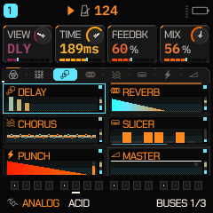

# Fase 4 — FX, FX BUS y procesamiento de audio

**Ámbito:** auditoría de los efectos que existen, corrección de defectos y rediseño de la pantalla
`FX > BUSES`. Todo lo que sigue se midió en este árbol: banco de render en host x86 (190 pantallas ×
22 paletas), `regress` (285 renders dorados + comprobaciones de salud y CPU), `ui_test`,
`tests/target_budget.py` y el enlace real del AC791N. **No hay unidad física aquí**, así que nada de
esto está escuchado ni probado en hardware.

---

## 1. Qué está conectado al audio real

### 1.1 Método

Se extrajeron los 51 parámetros que las páginas de la familia `FAM_FX` muestran (`params.c`) y se
buscó cada uno en los ficheros que forman el camino de audio (`fx.c`, `slicer.c`, `eng_drum.c`,
`eng_analog.c`, `voice.c`, `mix.c`, `mod.c`, `perform.c`). **50 de 51 aparecen leídos por su nombre.**
El que faltaba, `G_SLT6` (la pista 6 dentro del bus del slicer), sí se lee: `slicer.c` lo indexa como
`G_SLT1 + k` con `k < NTRK`, así que la búsqueda literal no lo veía.

**Resultado: ningún control de la familia FX es sólo decorativo.** No hay un parámetro que se dibuje
y no llegue al DSP.

### 1.2 Inventario real

| Página | Parámetros | Dónde suena |
|---|---|---|
| `FX` (por pista) | DIST, CHOR, DLY, REV | envíos de la parte (`fx.c` `mix_part`) |
| `DIST` | AMOUNT, TYPE, TONE | `DT_SOFT / TAPE / HEARTH / FLUX` en `fx.c` |
| `AUTO PAN` | DEPTH, RATE, SYNC, WAVE | LFO de panorama por parte (`fx.c`) |
| `DLY` | TIME, FEEDBK, COLOR, MIX | línea de retardo con filtro en la realimentación |
| `DLY 2` | WIDTH, GRAIN, SPREAD, MOD | lectura estéreo, grano y modulación de la línea |
| `DLY 3` | TYPE, PING-PONG | ANALOG / DIGITAL, ping-pong (0.6.90) |
| `REVERB` | TYPE, SIZE, DAMP, PRE | ROOM / SPRING / **SHIMR** / RESO / **CLOUD** |
| `REVERB 2` | MOD, RATE, FILT, WIDE | modulación de la cola, tono, anchura |
| `CHORUS` | TYPE, RATE, DEPTH, STEREO | **CHORUS / PHASER / FLANGER** (0.4: el flanger vive aquí) |
| `SLICER` | MODE, PAT, RATE, DEPTH | GATE / STUT (`slicer.c`), su propio bus |
| `SL BUS` / `SL BUS 2` | T1..T6, SLFX | qué pistas entran y cuánto |
| `SL PITCH` | T, PITCH, LEN, QUALITY | por paso, dentro del slicer |
| `MASTER` | CLIP, PUNCH, DUCK, DREL | recortador, bus de bombo (`eng_drum.c`), ducking |
| `MASTER EQ` | MODE, FREQ, GAIN, Q | EQ paramétrico Peak / Notch / Shelf |
| `STEREO M/S` | WIDTH | M-WIDE del maestro |

Es decir: **Phaser, Flanger, Shimmer, EQ paramétrico, M-WIDE y Tape ya existen** en el DSP; no son
nombres nuevos que hubiera que añadir.

## 2. Defectos encontradas y corregidas

Estas son las que se pudieron **probar** en este entorno:

1. **Elementos desbordados en FX BUS.** La fila de la cadena metía un icono y tres letras en celdas de
   27 px: el texto se salía de su celda en las 22 paletas. El lint del banco de render lo midió: **795
   hallazgos** (`spills out of its cell`). Ahora la cadena se lee por iconos y el hallazgo es **0**.
2. **Etiquetas del pie.** `1 CHAIN  2-4 PARAMS` y el nombre del enlace eran texto fijo bajo los
   bloques. Eliminadas: las cuatro tarjetas de arriba ya nombran el enlace seleccionado y sus valores.
3. **Tablas redundantes en la pantalla.** `FXB_TABSEL` repetía los seis nombres de `FXB_BLOCKN`,
   `TAB2BLK` era una tabla de ocho enteros que decía `sel - 2` y `FXB_TABN` murió con las etiquetas.
   El pie lee la tabla de los bloques y el marco del bloque seleccionado se calcula.
4. **Crash del banco de pruebas.** `tests/ui_render.c` imprimía un hallazgo con `%s` sobre una caja sin
   etiqueta y **segfaultaba** (lo destapó ASan al volcar esta pantalla). Ahora dice `(unlabelled)`. Sin
   ese arreglo, un defecto real de la UI podía tumbar el volcado en vez de reportarse.

## 3. El rediseño de FX BUS

Antes: seis bloques de 76 × 40 en tres columnas, el tercio inferior del lienzo vacío, un pie de texto
haciendo de leyenda y ningún icono. Ahora:

- **La cadena** es una fila de ocho celdas de 27 px con **el icono propio de cada enlace** (mezcla,
  modular, delay, reverb, chorus, slicer, acento, nivel). La seleccionada va en el color de acento, y
  **un punto recorre la fila mientras alguno de los ocho buses lleva señal**: el camino se ve, no se
  adivina.
- **Los seis bloques** son dos columnas de 116 × 34 — el dibujo de cada efecto es **tres veces más
  ancho** que antes (un tren de ecos, una cola o un barrido de chorus se leen mejor de lado) y el
  lienzo se usa hasta el pie.
- **Cada bloque** lleva el icono de su efecto, su lámpara de actividad (3 px en reposo, 4 px y hacia el
  calor cuando el bus lleva señal), **dos medidores reales** en su borde derecho —SEND arriba, RET
  abajo, ambos de `fx_vu`— y un suelo con degradado por tramado (`gw_dither`, dos bandas) sobre los
  tokens de la paleta.
- **Nada es un mockup**: los medidores y las lámparas leen `fx_vu`, los dibujos leen `song.g[...]` y
  `t->p[...]`, y las condiciones de encendido (ECO, modo del slicer, punch) son las del motor.
- **Sin movimiento sin sonido**: si los ocho buses están a cero, la página dibuja un cuadro fijo.

## 4. Presupuesto

| Medida | Antes | Ahora |
|---|---|---|
| Imagen (región XIP 581 564 B) | 581 344 B | **581 344 B** |
| `XIP code` / constantes | 403 996 / 157 032 | 403 996 / 157 032 |
| RAM `.data+.bss` (tope 96 KiB) | 87 764 B | 87 764 B |
| Pool | 305 096 B | 305 096 B |
| Presupuestos de ciclos | `perf_block 254/253`, `rev_room 243/243`, DRUM 1153/1153 | **idénticos** |

La pantalla nueva cupo quitando lo que ya no hacía falta (las tablas y las etiquetas del pie): el
rediseño se pagó con lo que se borró. **El margen queda en 220 B.**

## 5. Lo que NO se hizo, y por qué

- **Efectos nuevos (Tremolo, Ring Mod, Bitcrusher, SRR, Fuzz, Wavefolder, Compressor, Limiter, Reverse
  Delay…).** Con 220 B de margen no cabe ninguno: el enlace está a 220 B del techo de la región XIP y
  un efecto con su estado, su página y su parámetro ronda los cientos de bytes. Añadirlos exige o bien
  liberar flash de verdad (una decisión sobre el mapa de flash, que el dueño ha pedido no tocar) o
  quitar algo de lo que ya suena. Además, varios de los pedidos **ya existen** (ver §1.2): el flanger,
  el shimmer y el phaser no son huecos.
- **Una visualización propia por efecto.** Hoy sólo `FX > BUSES` y las páginas de slicer tienen
  gráfico (`GR_FX_BUSES`, `GR_SLCR`, `GR_SLPIT`); las demás son páginas de parámetros (`GR_NONE`).
  Cada gráfico nuevo es una función más en la imagen, y el presupuesto no da.
- **La auditoría audible** (pops, cortes, fase, acumulación de graves, niveles). El código ya trae
  trabajo explícito en esa dirección —fades por bloque en LEVEL / PAN y en el delay, *glide* de DEPTH y
  MIX, rampas de ganancia en la reverb, `fx_gate` para el silencio de los buses, `fx_insane` para
  detectar desbordes— pero **un pop no se oye en un test de host**: hace falta la unidad, o al menos
  alguien escuchando. No voy a declarar «corregidos» defectos que no he podido reproducir.

## 6. Pruebas ejecutadas en este árbol

| Prueba | Resultado |
|---|---|
| Barrido 190 pantallas × 22 paletas | **0 hallazgos de lint**, 0 tintas sobre su propio color, 0 píxeles GREY/MONO fuera de gris, **0 px de desalineación** en 3 155 200 medidas |
| `MENU > LARGE` (FLAT y LINE, todas las paletas) | 0 hallazgos; 4 400 pantallas con tarjetas altas |
| `build/host/regress tests/golden.txt tests/cpu_baseline.txt` | 285 renders dorados, **0 cambiados**, 0 fallos de salud, 0 voces/routing, 0 crashes. **La fila de CPU falló por el host, no por el código**: dos pasadas del mismo binario dieron «34 %» y «47 % más lento que su base» con la carga del VM a 0.26, y el propio test avisa de que así no puede separar un cambio de una máquina lenta. Lo que mide ciclos de verdad —`tests/target_budget.py`, conteo estático de instrucciones— pasa con los mismos números |
| `build/host/ui_test` | all passed |
| `tests/target_budget.py` | todos los presupuestos ok, con los mismos costes que antes |
| Enlace AC791N + `.fwsc` | `image 581 344 B`, paquete 610 959 B, identidad FM-1_965 |
| ASan sobre el banco de render (volcado de FX BUS) | sin errores tras el arreglo del §2.4 |

**No ejecutado / no verificable aquí:** audio real, latencia, clipping audible, estabilidad en la
unidad. Ninguna de las cifras de arriba dice nada sobre el FM-1 físico.
