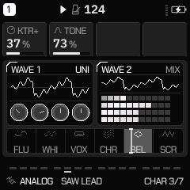
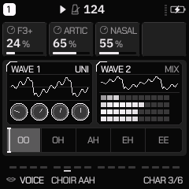
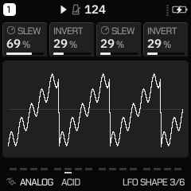

# QG — Fase 2: motores, EDIT, ENV, LFO y modulación

**Fase:** 2/6 · **Fecha:** 13 de noviembre de 2026
**Base:** `main` (v2.9.7) · **Rama:** `freebuff/222b35789f0959dc0a20e352`
**Alcance:** implementación real sobre el DSP de `firmware/src`, sin parámetros ficticios ni páginas vacías.

## 0. Qué está verificado y qué no

| Afirmación | Clase de evidencia |
|---|---|
| Compila en host (`tests/hostsim.c`, `tests/regress.c`, `tests/phase2_test.c`, `tests/ui_render.c`) | **Compilado y ejecutado en host x86_64 Linux** |
| Los presets de fábrica suenan **bit-idénticos** con la Fase 2 cargada | **Medido en host**: `tests/regress.c`, 285 renders, `0 changed` |
| Cada control nuevo mueve las muestras | **Medido en host**: `tests/phase2_test.c` (hash FNV de 200 bloques por render, un `fork()` por render) |
| Los valores nuevos viajan en el proyecto | **Medido en host**: `proj_pack` → `proj_import` en `tests/phase2_test.c` |
| Las páginas nuevas se dibujan y pasan el lint | **Medido en host**: `tests/ui_render.c`, 189 pantallas × 22 paletas, **0 lint findings**, **0** medidas de alineación fuera por ≥1 px |
| CPU del target (instrucciones / bloque de 32 muestras) | **No medido**: no hay `JIELI_TOOLCHAIN` ni `AC79_SDK` en este entorno |
| Flash / `.data+.bss` del target | **No medido**: sin build AC791N. La estimación de RAM nueva es 216 B (abajo) |
| Comportamiento en la FM-1 física | **No medido**: no hay unidad; no se declara validación física |
| Capturas | **Renderer nativo** (`tests/ui_render.c`, mismas fuentes de dibujo), no hardware |

Presupuesto de referencia (**no re-medido aquí**): imagen 531 204 B / 581 632 B; `.data+.bss` 96 088 B / 98 304 B
(holgura **2 216 B**); RAM de código 19 444 B / 24 576 B; pool spare 9 248 B. La Fase 1 no se toca.

---

## 1. Por qué no hay parámetros nuevos (`P_*`)

`P_COUNT = 125`: los registros de movimiento y los stores guardan el id en **7 bits** (127 máximo), y los
formatos FUNB/FUNC, los presets de usuario (`UP_PMAX * 2 = 144`) y el editor están construidos sobre esa
tabla. Añadir un `P_*` común obliga a cambiar formatos de proyecto y preset; queda fuera de una fase que
debe mantener los presets antiguos.

La Fase 2 reutiliza **cuatro valores inertes** del motor DIGITAL retirado, que todo firmware guarda pero
ninguna página del build por defecto alcanza:

| Macro | Slot | Neutro | Control |
|---|---|---|---|
| `P_X0 = P_FM3_SUS` | CHARACTER 1 | 127 (0 %) | KTR+, TONE, HARM, BITS+, LEAK, F3+, BAND, WARP |
| `P_X1 = P_FM3_LEVEL` | CHARACTER 2 | 127 (0 %) | TONE, FOLD, NOISE, RATE+, ROTOR+, ARTIC, EVOL, POSMOD |
| `P_MORPH = P_FM3_ATK` | CHARACTER 3 | 0 | sólo motores **sin** MORPH nativo: FM6, WHEEL, VOICE, NOISE, WTABLE |
| `P_X2 = P_FM4_SUS` | LFO SLEW | 127 (0 %) | tiempo del LFO |
| `P_X3 = P_FM4_LEVEL` | LFO INVERT | 127 (0 %) | polaridad del LFO |

`xamt()` devuelve `127 - p[k]`, así un preset o proyecto anterior (127 en esos slots) lee **0 %**. Todos los
caminos DSP saltan el cálculo cuando `xamt() == 0`: el render por defecto es **bit-idéntico** (verificado con
los 285 goldens). `P_COUNT`, FUNB/FUNC, `UP_*` y el protocolo del editor no cambian.

---

## 2. Inventario de controles (20, ocho motores)

| Motor | Página | Slots | Qué hace en el DSP |
|---|---|---|---|
| ANALOG | CHARACTER | `KTR+`, `TONE` | KTR+ añade seguimiento de teclado al corte (además del fijo de 1.0); TONE es un high-shelf de un polo después del filtro |
| FM6 | CHARACTER | `TONE`, `FOLD` | high-shelf y wavefolder simétrico (armónicos impares) sobre la suma de operadores, después de la envolvente |
| PHASE | CHARACTER | `HARM`, `NOISE` | HARM pliega la onda (armónicos impares); NOISE inyecta ruido en el shaper con estado propio (`s[5]`) |
| LOFI | CHARACTER | `BITS+`, `RATE+` | baja la palabra (8→1 bits) y alarga el sample-and-hold; BYTE/FLOAT conservan su resolución propia |
| WHEEL | CHARACTER | `LEAK`, `ROTOR+`, `P.DCY` | fuga de barras vecinas (crosstalk), velocidad de rotor ×1..×4, decaimiento de percusión más largo |
| VOICE | CHARACTER | `F3+`, `ARTIC`, `NASAL` | sube F3 (hasta ×2), consonante de ruido en el ataque, sube F2 (hasta +50 %) |
| NOISE | CHARACTER | `BAND`, `EVOL`, `HPF` | segundo filtro de banda, deriva espectral más profunda, paso-alto posterior |
| WTABLE | CHARACTER | `WARP`, `POSMOD`, `FOLD` | deforma el punto de lectura (≤ ¼ de ciclo), camina MORPH con un seno lento, pliega la salida |
| DRUM-X | — | — | **sin banco**: sus páginas ya cubren lanes, transient, pitch envelope, tune, decay y kits; añadir sería duplicar |

Además:

| Área | Control | Implementación |
|---|---|---|
| LFO | `HSIN`, `PULSE` | dos formas nuevas al final de `N_LWAVE` (7, 8); las anteriores conservan su número |
| LFO | `SLEW` | suaviza cada paso de S&H / EVO (`track_lfo_tick`) |
| LFO | `INVERT` | invierte la polaridad después de la forma |
| ENV | `VEL` | `P_DXIMG` en motores ≠ DRUM: 127 = curva de siempre, 0 = velocidad plena; DRUM conserva IMAGE |
| Matriz | `MD_X1..MD_X4` | cuatro destinos nuevos **al final**, después de `MD_PNCH`: los números guardados no se desplazan |

LFO2 sigue descartado: no hay espacio persistente para su fase/estado sin tocar formatos. Queda documentado,
no implementado.

---

## 3. EDIT contextual

- **`CHARACTER`** (familia EDIT, ámbito motor, tras `EDIT 2`): título por motor (`page_title[2]`, "CHAR");
  3 knobs. En motores con MORPH nativo el tercer slot se dibuja vacío (`page_desc` devuelve `0`), nunca un
  control ficticio. Visible sólo si el motor tiene banco (`ch_n >= 2`).
- **`LFO SHAPE`** (familia LFO, ámbito track, tras `LFO DEST`): SLEW e INVERT, con etiquetas propias.
  Oculto en un build `FELUCCA_FM4=1` sobre DIGITAL, donde esos ids son la envolvente de sus operadores.
- **`VOICE 2`**: tercer knob `VEL` en motores ≠ DRUM (`P_DXIMG`), con etiqueta propia.
- `track_desc` / `param_desc_of` devuelven la etiqueta del motor para `P_X0/X1` y para `P_MORPH` cuando es
  CHARACTER 3; el editor, los presets y los proyectos ven el nombre correcto.

Capturas (renderer nativo, paleta GREY):





---

## 4. Validación ejecutada (host x86_64 Linux)

```text
python3 -c "import sys; sys.path.insert(0,'tools'); import build; build.generate()"
cc -O2 -w -Ibuild/gen -Ifirmware/src -o build/host/regress tests/regress.c -lm
build/host/regress tests/golden.txt tests/cpu_baseline.txt
  -> 285 golden renders (0 changed, 0 gone), 0 health failures, 0 voice/routing failures,
     0 CPU entries over budget

cc -O2 -w -Ibuild/gen -Ifirmware/src -o build/host/phase2_test tests/phase2_test.c -lm
build/host/phase2_test
  -> phase2: PASS (CHARACTER per engine, LFO SHAPE, ENV VEL, pages, project round trip)

cc -O1 -w -Ibuild/gen -Ifirmware/src -Itests -o build/host/ui_render tests/ui_render.c -lm
build/host/ui_render build/ui_new build/ui_slot
  -> 189 screens x 22 palettes + the page/value sweep; 0 lint findings, 0 GREY/MONO pixels off,
     0 alignment measurements off by 1 px or more (3 390 514 measurements)
```

`tests/phase2_test.c` hace un `fork()` por render (estado DSP como en el arranque, igual que `regress.c`),
hashea 200 bloques de 32 muestras y exige:

1. para cada motor con banco y cada slot, un render distinto al neutro (con un preset donde el control
   aplica: LOFI `PULSE LD`, WHEEL `JAZZ PERC`);
2. LFO SLEW e INVERT audibles con el LFO en PITCH y onda S&H; el neutro repite el hash;
3. ENV VEL: una nota suave sube de nivel con `VEL = 0`; `VEL = 127` repite la curva;
4. las páginas existen una sola vez, `page_desc` devuelve etiqueta y puntero correctos, y el tercer slot
   sólo aparece en motores de tres;
5. `proj_pack` → `proj_import` conserva los cuatro slots y MORPH.

## 5. Recursos

- **RAM nueva (estimación estática)**: `eng_noise.c` añade tres arrays `int32_t[VPOOLN]` (BAND y HPF):
  `3 × 18 × 4 = 216 B` de `.bss`. El resto de estados nuevos usa campos libres de `voice_t`
  (`s[3..6]`, `ph[]`) o arrays ya existentes.
- El `engine_t` crece 12 B (puntero + contador + padding + tercer título) por motor, en **rodata** (flash);
  dos entradas nuevas en `PAGES[]`, también rodata. No hay `malloc` ni estado por nota nuevo.
- **Holgura de `.data+.bss` de referencia: 2 216 B.** 216 B dejan 2 000 B. **No re-medido en target**:
  `tests/memory_map_test.py` necesita el `.elf` de AC791N, que este entorno no puede producir.
- **CPU**: sin build de target no se puede leer `tests/target_budget.py`. En host, los goldens y el presupuesto
  de CPU de `regress.c` siguen en verde; eso es una medida de host, no del pi32v2.

## 6. MIDI, panel y presets

- **Panel**: las páginas nuevas están en `PAGES[]` con knobs reales; `ui_render` las dibuja en las 22 paletas.
- **MIDI**: cada control es un parámetro con id < `P_COUNT`, por lo que entra en la matriz (destinos `X1..X4`)
  y en el guardado; los CC de modulación y aftertouch llegan a través de las ranuras de `mod.c`, que ahora
  aceptan los destinos X.
- **Presets de usuario**: guardan `P_COUNT` valores (`UP_PMAX * 2 = 144`), así que los slots nuevos viajan
  sin cambiar el formato. Los presets antiguos leen 127 en ellos = neutro.
- **Proyectos**: `FUNC` conserva los 125 valores; round trip medido en `phase2_test`.

## 7. Limitaciones declaradas

- No hay build AC791N, `.fwsc`, ni medición de flash/RAM/CPU del target en este entorno.
- No hay FM-1 física: **ninguna** afirmación de sonido en hardware, latencia o clicks en la unidad.
- La capturas son del renderer nativo (`tests/ui_render.c`), no de la pantalla del instrumento.
- `HSIN`/`PULSE` y `SLEW`/`INVERT` están validados en host; falta la pasada en unidad.
