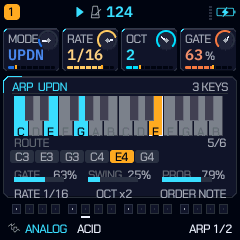
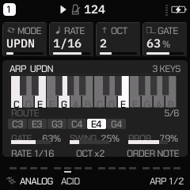

# QG — Fase 3: performance, pantallas y deuda de pruebas

**Fecha:** 13 de noviembre de 2026 · **Clase de toda medida de este documento: host x86** (el C del firmware
compilado para el host; no es AC791N, no es el emulador y no es la FM-1).

**Estado:** parcial y deliberado. Esta pasada cierra el defecto real que quedaba en la pantalla ARP y la deuda de
pruebas que dejó la Fase 2. No reimplementa lo que ya estaba hecho en 6.1–6.4 y no presenta como terminado lo que
sigue pendiente (§6).

---

## 1. Punto de partida: qué ya existía (y por qué no se duplicó)

La auditoría de las pantallas y de `PAGES[]` encontró que la mayor parte del rediseño que pide la Fase 3 ya está en
el árbol, con pruebas:

| Paso | Lo que ya había | Dónde |
|---|---|---|
| 2 · SEQ | OVERVIEW, STEP GRID, PIANO ROLL, DRUM GRID, CONDITIONS, LOCKS, AUTOMATION, EUCLIDEAN, MUTATE, TOOLS y PLAYHEAD; microtiming, probabilidad, ratchets, fills, escenas, undo | `ui_graph.c`, `ui_seqtools.c`, `seq.c`, `motion.c`; `ui_test`, `ratchet_test`, `motion_test` |
| 3 · SCL | SCALE (círculo + teclado), CHORD (voces y strum), PROG; raíz, intervalos, acordes, inversiones y respuesta visual | `ui_scl.c`; `ui_render` 0 hallazgos, `ui_test` |
| 4 · FX | 16 páginas, `FX > BUSES` como consola de ruteo, medidores con una sola balística (`fx_meter_step`), flanger, M-WIDE con potencia constante | `fx.c`, `ui_fxb.c`, `docs/QG_SCL_FX_REDESIGN.md`, `docs/QG_FX_AUDIT.md` |
| 5 · Identidad | suelo Solar Heat en los paneles (`graph_heat`), degradados y dither de HOME (`hv_grad`), anillos, espectros y medidores ya existentes | `ui_graph.c`, `ui_homeviews.c`, `gfx.c` |
| 6 · Pantallas nuevas | OVERVIEW, MIXER, PERFORMANCE, ROUTING y SYSTEM en HOME; CPU/carga del ISR, voces, batería y reloj en SYSTEM; visualizador espectral | `ui_homeviews.c`, `ui_tech.c`; `docs/QG_HOME_VIEWS.md` |

Por eso esta pasada no añadió una segunda pantalla de SEQ, otro BUSES ni otro medidor: habría sido duplicar lo que
ya funciona. Lo que sí quedaba era un defecto de representación en ARP.

---

## 2. Paso 1 · ARP: de barras inventadas a datos del motor

### 2.1 El defecto

`graph_arp()` dibujaba 16 barras cuya altura salía de una fórmula sobre el índice del paso
(`(i * 37u + 11u) % hmax`) y de una tabla de modos. No leía las notas retenidas, ni la nota que el arpegiador estaba
tocando, ni el recorrido real. Era una visualización decorativa: exactamente lo que la Fase 3 prohíbe.

### 2.2 Lo que dibuja ahora

Todo sale de `track_t` y de los parámetros que el motor ya toca:

- **Teclado de dos octavas** alrededor de las teclas retenidas: blancas y negras en su posición de piano, las
  retenidas en el tema, la que suena (`arp_note`) y las del acorde (`arp_ch[0..2]`) en acento. Si las teclas abarcan
  más de dos octavas, la ventana se desplaza para incluir el extremo superior.
- **Recorrido**: la lista que construye `arp_step()` — teclas en orden de nota o de pulsación (`ORDER`), expandida
  por `OCT`, con `REPEAT`, `UP+8` y `CHORD` como el secuenciador—. Cada nota es una pastilla con su octava; la que
  está sonando se marca en acento y el contador dice `posición/total`. `RND` dice `RND` y no finge una posición;
  `TRNS` dice `TRNS`; sin teclas dice `NO KEYS`.
- **GATE / SWING / PROB** como medidores con el valor almacenado y su porcentaje; `RATE`, `OCT` y `ORDER` en el pie;
  el modo y `LATCH`/`n KEYS` en la cabecera.
- Con el arp apagado no se dibuja recorrido: la pantalla lo dice (`OFF`) en lugar de inventar actividad.

La geometría cabe en el panel de 240 × 122 (`cv_oy = 0` para esta página): cabecera 2..16, teclado 20..60,
recorrido 59..87, medidores 91..106, pie 110..119.

### 2.3 Una sola fuente para el recorrido

La fórmula que decide qué nota toma cada paso estaba duplicada si la pantalla la recalculaba. Se extrajo a
`arp_step_index()` en `seq.c`; `arp_pick()` y `arp_route_now()` (UI) llaman a la misma función. `RND`, `WALK` y
`CHORD` conservan su tratamiento propio porque dependen del generador, del estado de paseo o suenan todos a la vez.
La pantalla no puede desviarse del DSP sin que se vea en el mismo código.

**No hay DSP nuevo ni parámetros nuevos**: `P_COUNT` sigue en 125 y los 285 renders dorados quedan bit-idénticos.

---

## 3. Deuda de pruebas de la Fase 2, corregida

`ui_test` no se había ejecutado al cerrar la Fase 2 y fallaba en cinco comprobaciones, todas de expectativas, no de
sonido:

1. Los ciclos de EDIT no incluían la página `CHARACTER` (ANALOG y FM6). Se añadió a `CYC_A` y `CYC_F`; DRUM no la
   tiene (`ch_n = 0`) y su ciclo sigue igual.
2. Las comprobaciones de «las páginas de operador están ocultas» identificaban por rango de ids
   `P_FM1_ATK..P_FM4_LEVEL`. La Fase 2 reutilizó `P_FM3_SUS/LEVEL` y `P_FM4_SUS/LEVEL` como `P_X0..P_X3`, así que
   `CHARACTER` (`id[0] == P_X0`) caía dentro del rango. Las pruebas ahora excluyen `P_X0` explícitamente y el
   comentario dice por qué; el firmware ya tenía su retorno propio para CHARACTER antes del rango, así que no se
   cambió comportamiento.

Resultado: `ui_test` **all passed**, incluidas navegación, guardado, carga, REC/MIDI, capas, HOME y los ciclos de
EDIT.

---

## 4. Evidencia ejecutada

| Comprobación | Clase | Resultado |
|---|---|---|
| `build/host/ui_render` | host x86, 189 pantallas × 22 paletas | **0 hallazgos de lint**, 0 tintas sobre su propio color, 0 píxeles GREY/MONO fuera de gris; **3 390 046** medidas de alineación, **0** desviadas |
| `build/host/ui_test` | host x86 | **all passed** |
| `build/host/regress tests/golden.txt tests/cpu_baseline.txt` | host x86 | **285 renders dorados, 0 changed**, 0 fallos de salud/voces/ruteo, 0 entradas de CPU fuera de presupuesto |
| Capturas | renderer nativo GREY / QUANTUM | `docs/captures/fase3/arp_grey.png`, `arp_quantum.png`; hoja completa `sheet_grey.png` |

La escena `arp` de `tests/ui_render.c` ahora representa un arp real: tres teclas retenidas (C3 E3 G3), `UPDN` sobre
dos octavas, paso 4 de 6 sonando (E4). Antes la escena se renderizaba con el arp apagado y no ejercitaba el dibujo.

---

## 5. Lo que se auditó y no necesitó cambios

- **SAVE-PRESETS y navegación**: cubiertos por `ui_test` (guardado, nombre, slots, proyecto, REC, capas, HOME);
  verdes. No se encontró un defecto que justificara tocar el orden de inicialización.
- **Planetas, bootsplash y animaciones**: no se midieron ni se tocaron en esta pasada. El arranque ya está
  documentado como no medible en host (`docs/QG_SOLAR_HEAT_UI_REDESIGN.md` §2 quater); reducir sus tiempos sin la
  unidad sería optimizar a ciegas.
- **FX**: las representaciones de `FX > BUSES` ya leen `fx_vu[]` y `fx_meter_step()`; no se añadió otra
  visualización paralela.

---

## 6. Lo que queda abierto de la Fase 3 (no se presenta como hecho)

1. **Identidad Solar Heat en todas las pantallas**: el suelo y los degradados existen en los paneles y en HOME, pero
   no se aplicaron partículas/transiciones nuevas a cada una de las 189 escenas. Hacerlo sin medir el coste de draw
   en la FM-1 repetiría el error que el propio `AGENTS.md` prohíbe.
2. **Capturas de las 189 pantallas una por una**: el barrido las renderiza y la hoja `sheet_grey.png` las reúne; no
   se versionaron 189 × 22 PNG sueltos.
3. **Auditoría de defectos de planetas, bootsplash y animaciones**: sin unidad física no hay cronómetro ni panel que
   medir; queda como deuda declarada.
4. **Medición en target**: sin `JIELI_TOOLCHAIN`/`AC79_SDK` no hay `.elf`, `.fwsc`, `memory_map_test.py` ni
   `target_budget.py`. El coste de pila del dibujo (lista local de 64 notas, ~256 B) no está medido en la tarea de UI
   del target.
5. **Emulador/WASM**: sin `emcc` no se reconstruyó; las capturas son del renderer nativo, no del navegador.
6. **Ninguna escucha**: no se reprodujo audio en la FM-1 ni se juzgó cómo suena el arpegio.

**Fase 4 no se inicia**: la condición de cierre de la Fase 3 no se cumple todavía con evidencia de target/hardware.
